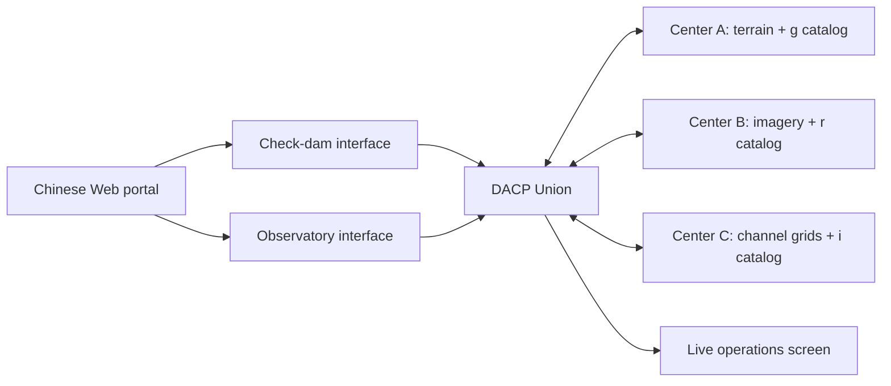

# CONET

[中文](README_zh.md)

CONET connects data centers through a DACP Union and provides Chinese-language scientific case interfaces and a live operations screen. Three local DACP nodes publish six datasets. Both cases submit fixed, variable-driven Jobs to the **same Union**; the Union selects execution placement and XStream executes the steps.

- **Check dams:** select a geographic box, identify synthetic dam structures, screen them against flash-flood-susceptible channels, and download a distribution map and GeoJSON.
- **Observatories:** select a sky cone, crossmatch synthetic g/r/i FITS catalogs, inspect colors and uncertainties, and download the matched catalog.
- **Operations screen:** member health, reported CPU/heap usage, task participation, observed inter-node task payloads, case activity and result counts. Unavailable measurements are shown as unknown.

All scientific data, telescope identities and dam targets are synthetic. These demonstrations are not hazard forecasts, engineering recommendations or physical source classifications.



## Start here

1. Follow [deployment](docs/deployment.md) to install dependencies, generate data, train the synthetic model and prepare runtimes.
2. Start the shared network and applications:

```bash
export DACP_HOME=/path/to/dacp-codex
.venv/bin/python manage.py up
.venv/bin/python manage.py status
```

3. Open `http://<machine-ip>:8870/`; the screen is `/screen`. The script prints the machine address. Cases are under `/cases/check-dams/` and `/cases/observatory/`. Case backends bind only to loopback on ports 8871/8872. The portal serves them on the same origin.
4. Select a region and submit an analysis. Actual Union execution state is displayed and completed results remain available after restart.
5. Stop only CONET's processes:

```bash
.venv/bin/python manage.py down
```

Existing independently running DACP/Union/website services are not managed by CONET. Startup does not deploy remote services.

## Guides

| Topic | Document |
|---|---|
| Installation, configuration, data generation, lifecycle | [Deployment](docs/deployment.md) |
| Inputs, algorithms, outputs, scientific limitations | [Scientific cases](docs/cases.md) |
| Case registration and observability | [Platform and extension contracts](docs/platform.md) |
| Tests, live results and repository submission status | [Verification](docs/verification.md) |

## Data and source distribution

The default generated input volume is approximately **1.99 GB combined**: 1,018,060,800 bytes for check dams and approximately 972 MB for astronomy (27 million rows). `.state/` contains data, model weights, credentials, logs, generated operators and results and is ignored by Git. Runtime wheels are also ignored. Only source, configuration, tests, lightweight documentation images and generation scripts belong in Git.

## Tests

```bash
.venv/bin/python -m unittest discover -s tests -v
.venv/bin/python scripts/smoke_web.py --url http://127.0.0.1:8870
```

The smoke test submits two real Jobs; it requires a running CONET installation with generated data and runtimes.
