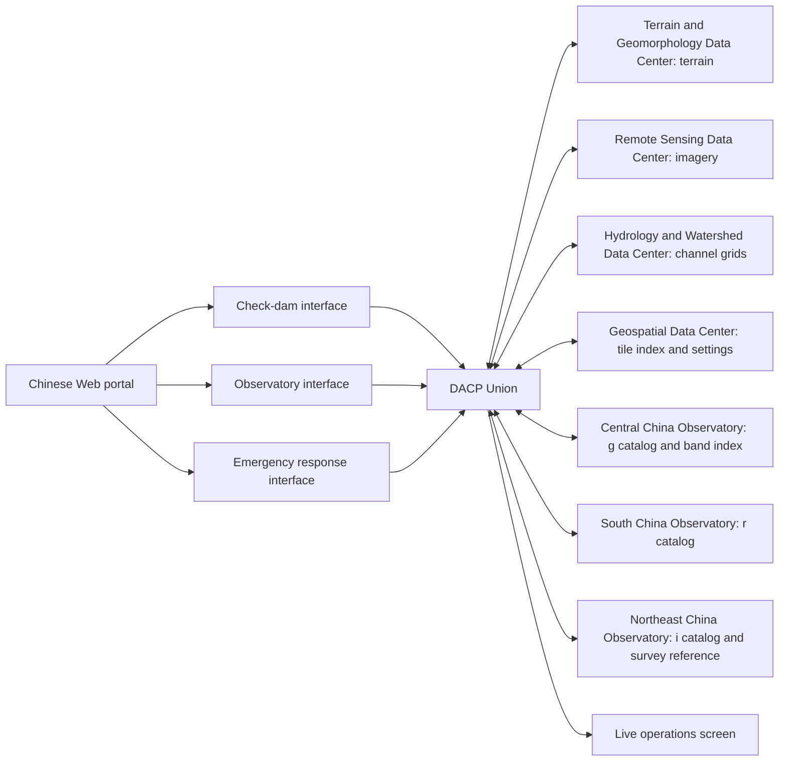

# CONET

[中文](README_zh.md)

CONET connects data centers through a DACP Union and provides Chinese-language scientific case interfaces and a live operations screen. Seven local DACP nodes publish fourteen datasets: ten scientific source datasets and four small reference datasets. All three cases submit fixed, variable-driven Jobs to the **same Union**; the Union selects execution placement and XStream executes the steps.

- **Check dams:** select a geographic box, identify synthetic dam structures, screen them against flash-flood-susceptible channels, and download a distribution map and GeoJSON.
- **Observatories:** select a sky cone, crossmatch synthetic g/r/i FITS catalogs, inspect colors and uncertainties, and download the matched catalog.
- **Emergency response:** earthquake and mudslide templates combine four centers, extract changes, assess synthetic exposure and report missing/stale observations. See the [emergency case](docs/emergency.md).
- **Operations screen:** member health, reported CPU/heap usage, task participation, observed inter-node task payloads, case activity and result counts. Unavailable measurements are shown as unknown.

All scientific data, telescope identities and dam targets are synthetic. These demonstrations are not hazard forecasts, engineering recommendations or physical source classifications.



## Implementation

The CONET application uses **Scala 2.13 on Java 17**. One JVM hosts the portal, operations screen APIs and all three case backends; the `bin/conet` CLI manages the seven-node network and Union. Scientific operators, synthetic-data generators, model training and offline preparation/publication tools use Python and its scientific libraries. Browser visualizations use JavaScript, HTML and CSS.

Build and test with `sbt test stage`, then use `bin/conet up`, `status`, `restart-web` or `down`. See [deployment](docs/deployment.md) for SDK dependencies and data preparation.

## Start here

1. Follow [deployment](docs/deployment.md) to install dependencies, generate data, train the synthetic model and prepare runtimes.
2. Start the shared network and applications:

```bash
export DACP_HOME=/path/to/dacp-codex
bin/conet up
bin/conet status
```

3. Open `http://<machine-ip>:8870/`; the screen is `/screen`. The script prints the machine address. Cases are under `/apps/check-dams/` `/apps/observatory/` and `/apps/emergency/`. All applications are served by the portal on the same origin; no separate case HTTP listeners are started.
4. Select a region and submit an analysis. Actual Union execution state is displayed and completed results remain available after restart.
5. Stop only CONET's processes:

```bash
bin/conet down
```

Existing independently running DACP/Union/website services are not managed by CONET. Startup does not deploy remote services.

## Guides

| Topic | Document |
|---|---|
| Installation, configuration, data generation, lifecycle | [Deployment](docs/deployment.md) |
| Inputs, algorithms, outputs, scientific limitations | [Scientific cases](docs/cases.md) |
| Case registration and observability | [Platform and extension contracts](docs/platform.md) |
| Tests, live results and repository submission status | [Verification](docs/verification.md) |

## Data and source distribution

The default generated input volume is approximately **2.99 GB combined**: 1,018,060,800 bytes for check dams and approximately 972 MB for astronomy (27 million rows), plus 1,004,268,424 bytes for emergency response. `.state/` contains data, model weights, credentials, logs, generated operators and results and is ignored by Git. Runtime wheels are also ignored. Only source, configuration, tests, lightweight documentation images and generation scripts belong in Git.

## Tests

```bash
.venv/bin/python -m unittest discover -s tests -v
.venv/bin/python scripts/smoke_web.py --url http://127.0.0.1:8870
```

The smoke test submits two real Jobs; it requires a running CONET installation with generated data and runtimes.

[Case maps and Tianditu configuration](docs/maps.md)

## Application development

Open `/appbuilder/` to configure, preview and publish analysis applications after signing in with developer permission. Each published app has an immediately accessible `/apps/<id>/` URL. See the [App Builder guide](docs/appbuilder.md) for configuration, usage statistics and extension contracts.


[Analysis product publication and sharing](docs/products.md): immutable results, generated provenance, multi-party rights review and read-only sharing.

[Workspace and shared hosting](docs/workspaces.md)

## Application delivery and file inputs

Design the workflow first, then its form, variable bindings and result views. Deliver the application as an importable/exportable [application package](docs/application-packages.md). [File inputs](docs/file-inputs.md) bind bounded browser uploads to run-scoped DACP Items. See `examples/uploaded-csv/` for CSV preview, column statistics and downloads. CONET connects eight Node members: seven scientific data centers and one shared hosting center, coordinated by a separate Union.

[Data catalog](docs/catalog.md) · browse at `/catalog/`.
