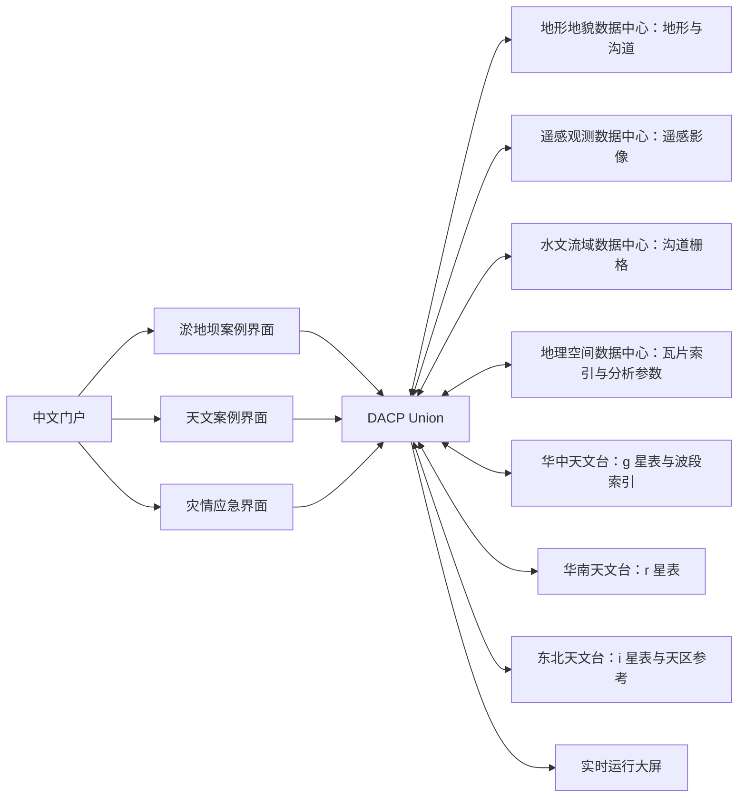

# CONET

[English](README.md)

CONET 通过 DACP Union 连接数据中心，提供中文科学案例界面和实时运行大屏。七个本地 DACP 节点发布十四个数据集：十个科学输入数据集和四个小型参考数据集。三个案例向**同一个 Union** 提交固定的变量化作业，由 Union 选择执行位置，XStream 执行各步骤。

- **淤地坝案例：**框选区域，识别合成影像中的坝体，结合易发山洪沟道筛选有效候选，下载分布图和 GeoJSON。
- **天文案例：**选择天区锥形区域，匹配合成 g/r/i 波段 FITS 星表，查看颜色和误差，下载匹配星表。
- **灾情应急：**地震与泥石流两种模板，联合四个中心完成变化提取、空间融合与影响统计，明确展示缺测与过期资料。详见[灾情案例](docs/emergency_zh.md)。
- **运行大屏：**展示成员健康状态、上报的 CPU/堆内存、任务参与次数、已观测的节点间任务载荷、案例活动和成果数量。不可用的指标明确显示为未知。

所有科学数据、天文台和坝体目标均为合成示例，不用于灾害预测、工程建议或天体物理分类。



## 技术实现

CONET 应用使用 **Scala 2.13 和 Java 17**。一个 JVM 提供门户、大屏 API 和三个案例后端；`bin/conet` 命令管理七节点网络及 Union。科学算子、合成数据生成、模型训练、离线准备与发布工具使用 Python 及其科学计算库。浏览器可视化使用 JavaScript、HTML 和 CSS。

执行 `sbt test stage` 构建及测试，再通过 `bin/conet up`、`status`、`restart-web`、`down` 管理服务。SDK 依赖和数据准备请参见[部署指南](docs/deployment_zh.md)。

## 快速入口

1. 按[部署指南](docs/deployment_zh.md)安装依赖、生成数据、训练合成模型并构建运行环境。
2. 启动共享网络和应用：

```bash
export DACP_HOME=/path/to/dacp-codex
bin/conet up
bin/conet status
```

3. 打开 `http://<machine-ip>:8870/`，大屏位于 `/screen`。脚本会输出本机地址。三个案例入口为 `/apps/check-dams/` 和 `/apps/observatory/`。所有应用由门户统一提供同源访问，不再启动独立案例 HTTP 监听端口。
4. 选择区域并提交分析。页面显示真实 Union 执行状态，完成后的成果在重启后仍可查看。
5. 仅停止 CONET 的进程：

```bash
bin/conet down
```

CONET 不管理其他独立运行的 DACP、Union 或官网服务，启动时也不部署远程服务。

## 指南

| 主题 | 文档 |
|---|---|
| 安装、配置、数据生成和启停 | [部署指南](docs/deployment_zh.md) |
| 输入、算法、输出和科学限制 | [科学案例](docs/cases_zh.md) |
| 案例注册和观测接口 | [平台与扩展契约](docs/platform_zh.md) |
| 测试、实测结果和算子提交状态 | [验证记录](docs/verification_zh.md) |

## 数据与源码

默认生成的两类输入合计约 **2.99 GB**：淤地坝数据 1,018,060,800 字节，天文数据约 972 MB（2700 万行）。`.state/` 保存数据、模型权重、凭据、日志、生成的算子和结果，已被 Git 忽略；运行环境依赖 wheel 文件也被忽略。Git 仅保存源码、配置、测试、轻量文档截图和生成脚本。

## 测试

```bash
.venv/bin/python -m unittest discover -s tests -v
.venv/bin/python scripts/smoke_web.py --url http://127.0.0.1:8870
```

冒烟测试会提交两个真实作业，需要已启动 CONET，并准备好数据和运行环境。

[案例地图与天地图配置](docs/maps_zh.md)

[第三个案例：灾情应急](docs/emergency_zh.md) · `/apps/emergency/`

灾情案例另增加 1,004,268,424 字节输入，入口 `/apps/emergency/`。

## 应用开发

打开 `/appbuilder/`，即可配置、预览和发布分析应用。每个应用发布后立即获得 `/apps/<id>/` 访问地址。配置、使用统计和扩展契约见 [App Builder 指南](docs/appbuilder_zh.md)。


[分析产品发布与分享](docs/products_zh.md)：固定成果、自动溯源说明、多方权益核对和只读分享。

[工作空间与共享托管](docs/workspaces_zh.md)

## 应用交付与文件输入

先设计流程，再配置表单、变量绑定和结果视图。应用以可导入导出的[应用程序包](docs/application-packages_zh.md)交付。[文件输入](docs/file-inputs_zh.md)将受限浏览器上传绑定到独立运行的 DACP Item。`examples/uploaded-csv/` 提供 CSV 预览、字段统计和下载。CONET 包含八个 Node 成员：七个科学数据中心与一个共享托管中心，由单独的 Union 协调。

[数据目录](docs/catalog_zh.md) · 浏览入口 `/catalog/`。
