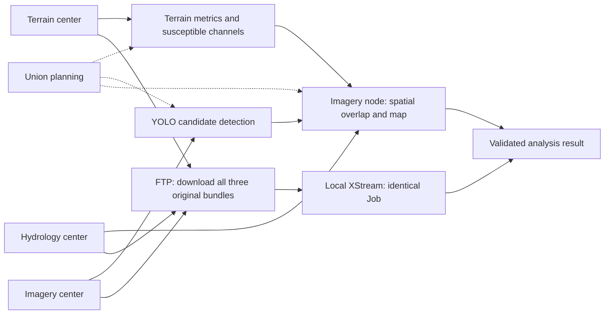
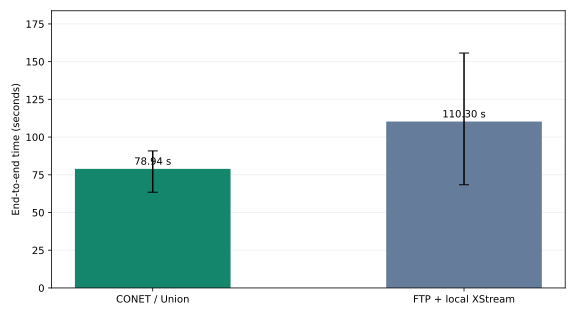
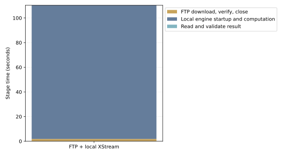

# Check-dam analysis: CONET versus FTP download-first processing

[中文](report_zh.md)

2026-11-08T11:48:15Z

**All existing services share one host, without bandwidth shaping or WAN simulation. Data are synthetic. This compares the existing CONET application with FTP download-first local execution, not protocols in isolation or real geographical-center performance.**

## One task, two execution paths



The diagram shows the current execution paths: Union plans, and data nodes execute their assigned steps. Exact placement is listed below.

## Inputs and result equality

- Terrain: `terrain.bundle`, 277,760,000 bytes; SHA-256 `eda7082e65f3113f3eec5ea5a85b6b34e90544e6d941ecd3335f88e9b319d4c4`.
- Imagery: `imagery.bundle`, 555,120,640 bytes; SHA-256 `cb4f2daf2a2397aeb1e26a24c06eb3eb637fac68c19abacb5e071f7357c83ded`.
- Channel grids: `channels.bundle`, 185,180,160 bytes; SHA-256 `ba58cd963acbddf8741688af11019fbb82cbfb30cef93a63edfccdb24dde780f`.

Source data total 1,018,060,800 bytes (1.018 GB, 970.9 MiB). The analysis uses the default first-tile polygon and confidence 0.35. All original bundles are retained, without cropping for the local path.

```json
{
  "region": {
    "type": "Polygon",
    "coordinates": [
      [
        [
          109.1107897841093,
          36.05322366614358
        ],
        [
          109.20694875299046,
          36.05322366614358
        ],
        [
          109.20694875299046,
          36.131268701939064
        ],
        [
          109.1107897841093,
          36.131268701939064
        ],
        [
          109.1107897841093,
          36.05322366614358
        ]
      ]
    ]
  },
  "min_confidence": 0.35
}
```

Every run has the same canonical full-analysis JSON digest: `d4014464d82a0e8b8769ef23bd77b449763027df2da43a7e0ea55af4b1ef04f8`. Each has 5 candidates, 3 valid sites, 4 rejection records and 361 inference windows. Validation includes all analysis metadata fields, not just counts.

## Measured time

Each path has 1 warmups and 3 measured runs, interleaved with a fixed random seed. Values are medians and min–max ranges, not confidence intervals.

| Path | Median end-to-end | Min–max |
|---|---:|---:|
| CONET / Union | 78.941 s | 63.429–90.821 s |
| FTP + local XStream | 110.297 s | 68.399–155.688 s |

Centralized / CONET time ratio: **1.40×**. Above 1 means CONET is faster; below 1 means centralized processing is faster.



### Centralized stages

| Stage | Median time |
|---|---:|
| Parallel FTP download, hash, write and close | 1.863 s |
| Local engine startup, computation and output write | 108.442 s |
| Read and validate full analysis result | 0.001 s |

Independent stage medians need not sum to the median total.



## Actual placement and remote payload

| Center | Steps |
|---|---|
| Terrain center | `terrain_data`, `terrain_metrics`, `susceptible_channels` |
| Hydrology center | `channel_grids` |
| Imagery center | `imagery`, `candidate_sites`, `spatial_overlap`, `distribution_map` |

Median observed remote payload across CONET node output ports is 185,218,313 bytes, versus 1,018,060,800 FTP source bytes per centralized run. CONET still transfers the full channel grid between nodes; it does not transmit only small results. These are not TCP/TLS wire-byte measurements. The final SVG is 14,814 bytes and is not the traffic total of the collaboration.

## Measurement boundaries

- CONET timing starts at the application request and includes queuing, Union planning, execution and packaging, ending after SVG retrieval and validation.
- Centralized timing starts before the three parallel FTP connections; each trial downloads anew. All downloads, verification and file close finish before local computation starts.
- The Job, parameters, operator packages and engine JARs match; only three URIs become local context: references. Local dependency parallelism is preserved.
- Local execution launches a fresh JVM, while CONET server JVMs persist. Operator processes/containers start normally; local computation includes engine startup.
- FTP is unencrypted; CONET uses its existing TLS. Security conditions differ and must be interpreted with the workload.
- Data, models and images are prepared outside timing. OS caches are not cleared; existing services share CPU, memory and disk.
- This tests one region and the current implementation on one host. Timings and payloads cannot establish a WAN speedup or describe repeated local analysis after downloading once.

## Individual trials and reproduction

| Measured repeat | CONET s | FTP centralized s |
|---:|---:|---:|
| 1 | 78.941 | 110.297 |
| 2 | 63.429 | 155.688 |
| 3 | 90.821 | 68.399 |

Of 3 paired measured runs, CONET is faster in 2 and centralized processing in 1. The small sample and overlapping ranges do not establish a stable speedup or statistical significance.


[Reproduction and prerequisites](README.md) · [Sanitized raw measurements](results.json)
