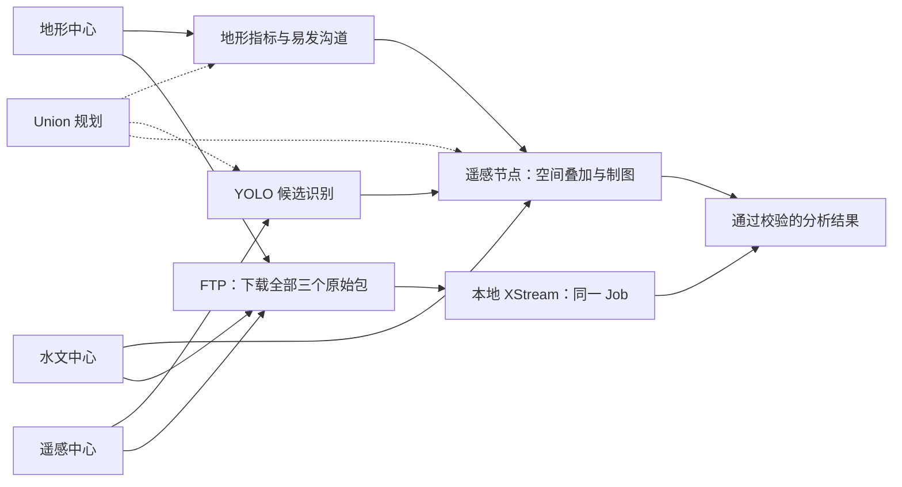
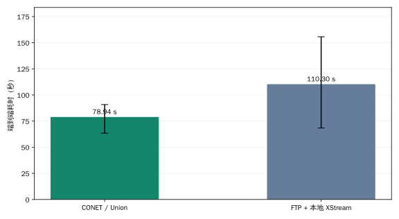
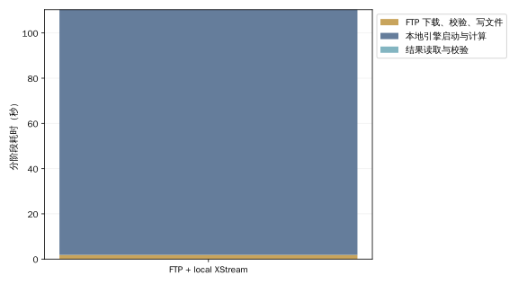

# 淤地坝案例：CONET 与 FTP 集中处理对比

[English](report.md)

2026-11-08T11:48:15Z

**已有服务均部署在同一台机器，未限速、未模拟 WAN；数据为合成数据。结果比较现有 CONET 应用与先 FTP 下载再本地执行的完整路径，不能解释成纯协议或真实跨地域性能。**

## 相同任务、两条路径



图示为当前执行路径；Union 负责规划，各数据节点执行分配给它们的步骤。具体分配见下表。

## 输入与结果一致性

- 地形数据: `terrain.bundle`, 277,760,000 bytes; SHA-256 `eda7082e65f3113f3eec5ea5a85b6b34e90544e6d941ecd3335f88e9b319d4c4`.
- 遥感影像: `imagery.bundle`, 555,120,640 bytes; SHA-256 `cb4f2daf2a2397aeb1e26a24c06eb3eb637fac68c19abacb5e071f7357c83ded`.
- 沟道栅格: `channels.bundle`, 185,180,160 bytes; SHA-256 `ba58cd963acbddf8741688af11019fbb82cbfb30cef93a63edfccdb24dde780f`.

源数据共 1,018,060,800 字节（1.018 GB，970.9 MiB）。分析范围为默认第一块瓦片多边形，识别置信度 0.35；三个源包均完整保留，未为本地路径裁剪。

```json
{
  "region": {
    "type": "Polygon",
    "coordinates": [
      [
        [
          109.1107897841093,
          36.05322366614358
        ],
        [
          109.20694875299046,
          36.05322366614358
        ],
        [
          109.20694875299046,
          36.131268701939064
        ],
        [
          109.1107897841093,
          36.131268701939064
        ],
        [
          109.1107897841093,
          36.05322366614358
        ]
      ]
    ]
  },
  "min_confidence": 0.35
}
```

所有运行的完整规范化分析 JSON 摘要一致：`d4014464d82a0e8b8769ef23bd77b449763027df2da43a7e0ea55af4b1ef04f8`。每次均有 5 个候选、3 个有效点、4 条剔除记录，推理 361 个窗口。校验包含分析元数据的全部字段，不仅是数量。

## 实测耗时

每条路径预热 1 次、正式运行 3 次，按固定随机种子交错执行。表中为中位数及最小—最大值，误差范围不是置信区间。

| 路径 | 端到端中位耗时 | 最小—最大 |
|---|---:|---:|
| CONET / Union | 78.941 s | 63.429–90.821 s |
| FTP + 本地 XStream | 110.297 s | 68.399–155.688 s |

集中处理 / CONET 耗时比：**1.40×**。大于 1 表示 CONET 较快，小于 1 表示集中处理较快。



### 集中处理阶段

| 阶段 | 中位耗时 |
|---|---:|
| FTP 并行下载、摘要校验、写入与关闭文件 | 1.863 s |
| 本地引擎启动与计算、成果写入 | 108.442 s |
| 读取并校验完整分析结果 | 0.001 s |

各阶段独立取中位数，相加未必等于总耗时中位数。



## 实际计算位置与跨节点负载

| 节点 | 步骤 |
|---|---|
| 地形地貌数据中心 | `terrain_data`, `terrain_metrics`, `susceptible_channels` |
| 水文流域数据中心 | `channel_grids` |
| 遥感观测数据中心 | `imagery`, `candidate_sites`, `spatial_overlap`, `distribution_map` |

CONET 节点输出端口记录的跨节点有效负载中位数为 185,218,313 字节；集中路径每次 FTP 下载 1,018,060,800 字节。前者仍包含完整沟道栅格的跨节点传输，不能宣称只传小结果；二者也不是 TCP/TLS 线速字节统计。最终 SVG 为 14,814 字节，不代表整个协作过程的传输量。

## 测量边界

- CONET 从提交应用请求计时，包含应用排队、Union 规划、执行和结果打包，直到获取 SVG 并校验。
- 集中路径从三个 FTP 连接开始计时，三个下载并行且每次重新下载，完整下载/校验/文件关闭 后才启动本地计算，不重叠下载与计算。
- 原 Job、参数、算子包和引擎 JAR 相同，只有三项 URI 改成本地 context:。本地不人为串行化 Job。
- 本地每次启动独立 JVM；CONET 的服务器 JVM 常驻。算子进程/容器均正常启动，本地计算阶段包含引擎启动时间。
- FTP 是明文；CONET 使用现有 TLS。网络安全条件不同，应结合应用场景解释。
- 数据、模型和镜像预先生成，不计入分析；不清理 OS 缓存，现有服务共享 CPU/内存/磁盘。
- 只测这一个区域、当前实现和同机部署。不能将实测耗时或负载外推为 WAN 加速倍数，也不将下载集中后重复分析的成本等同于每次重新下载。

## 逐次结果与复现

| 正式轮次 | CONET 秒 | FTP 集中处理秒 |
|---:|---:|---:|
| 1 | 78.941 | 110.297 |
| 2 | 63.429 | 155.688 |
| 3 | 90.821 | 68.399 |

三组成对正式运行中，CONET 有 2 组较快，集中处理有 1 组较快。样本数量有限且范围重叠，中位数比不是稳定加速保证，也不是统计显著性结论。


[执行方法与前提](README_zh.md) · [原始脱敏测量](results.json)
