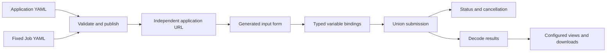

# Configuration-driven applications

Table previews display at most 10 data rows. The caption reports the total row count and preview size. Full result downloads retain all rows.

Published applications are listed on the **Application services** page (`/services/`), accessible from the primary navigation. The homepage focuses on the collaboration network and data centers.

[中文](appbuilder_zh.md) · [Home](../README.md)

CONET App Builder publishes analysis applications from an application definition and a fixed XStream Job. Published forms can be viewed anonymously; authoring and execution require no login. Union credentials and network endpoints are supplied by the CONET deployment; they are never entered in the browser.

## Publish an application

1. Open `/appbuilder/` from the portal's **应用工作台** navigation entry.
2. Load one of the three published applications as a template.
3. Click **新建应用** for a new draft, or select an application and click **编辑**. **复制应用** creates an independent draft without changing the original. Use the **应用信息**, **输入表单**, **变量绑定**, **结果与下载** and **运行设置** tabs for application configuration; **流程设计** opens XStream Job Designer; **YAML 源码** provides synchronized source editing.
4. Use **校验配置** to check both definitions, and **预览表单** to inspect the generated input form without submitting a job.
5. Click **发布应用**. The returned link `/apps/<id>/` is immediately usable without restarting the server. Share this URL with visitors who need to run the analysis.

Published pages are independent visitor interfaces: they display the application identity, input form, analysis progress, result views, downloads and collapsed history. They contain no workbench links, YAML editors or developer dashboards. The layout adapts to desktop and mobile screens. The share button provides the current application URL.

The portal homepage reads the same published-application registry. Each application card uses its configured title, description, cover and tags and links directly to `/apps/<id>/`. Publishing and updating applications updates this catalog without editing homepage HTML.

Published definitions survive restarts. To update an application, load its current definition before publishing; a revision check prevents overwriting another editor's changes. An application with queued or running jobs cannot be replaced. Application IDs determine stable URLs; changing the ID creates a separate application.



## Visual editing

Application information, input forms, variable bindings, results/downloads and run settings appear alongside workflow design in one tab row. Component types use selectable icon cards with visual examples. The recommended order is: design the Job → configure inputs → bind variables → configure results. Icon lists select fields and result components for editing in a single detail surface, with visual style examples. Numbers and booleans use typed controls without per-value type selectors. Groups use breadcrumb navigation within the same surface. Results have separate display-component, download-file and summary tabs. Options and metrics use compact rows; columns accept comma- or newline-separated names. Advanced settings contain metadata sources and projections; other source properties are preserved.

The variable list is extracted automatically from complete scalar Job references such as `$MIN_SNR`, excluding comments and ordinary prose. Variable names are read-only. Choose a form field, fixed value, dataset Item, contextual metadata or selection bounding box as the source; form fields and configured datasets use dropdowns. Unbound variables are marked, and Job changes refresh the list. Old bindings no longer used by the Job are listed separately for explicit cleanup. Editing order is flexible; publishing checks missing bindings and missing input fields.

**流程设计** opens the existing XStream Job Designer in a separate window and imports the current Job. Click **应用此 Job 并返回** to return the edited Job to the draft. Application forms, variable bindings and result views are preserved. A return from an old window cannot overwrite a different application. Allow browser popups, or download the Job YAML and import it manually.

Administrators configure `conet.yaml`:

```yaml
appbuilder:
  designer_url: http://10.0.82.103:8840/
  chat:
    codex_config: /home/cnic/.codex/config.toml
```

Window messaging validates the origin, window and random channel. Designer's restriction against iframe embedding remains enabled.

Switching to **YAML 源码** serializes the current visual model. Switching back parses the source and rebuilds the visual model. Extra configuration fields are preserved. Visual editing does not submit a Job; preview, validation and publication use the current model.

### Application covers

Basic information includes an image URL or a PNG/JPEG upload (maximum 2 MiB and 16 million pixels). Uploaded images are stored under `.state/appbuilder/media/` and use content-addressed URLs. `presentation.cover` accepts a local resource or HTTPS image URL; omitting it selects the shared default image. The bundled examples each supply their own illustration. `presentation.tags` accepts at most eight labels of at most 32 characters.

```yaml
presentation:
  cover: /assets/observatory-cover.svg
  tags: [Multi-band catalogs, Color analysis]
  notice: Synthetic data demonstration.
```

## Definition files

Each bundled case has `application.yaml` and `job.yaml`. The Scala `conet-appbuilder` submodule handles validation, variable binding, Union execution, queueing, history, cancellation, results and usage tracking. The three existing case pages retain their domain maps and sky plots and use the same shared browser runtime and backend as generated applications.

The complete examples are:

- [Check dams](../cases/check-dams/application.yaml): polygon and confidence inputs; SVG metadata decoding; map, table and downloads.
- [Observatory](../cases/observatory/application.yaml): cone, matching radius and signal-to-noise inputs; JSON decoding; sky and color scatter plots and CSV.
- [Emergency](../cases/emergency/application.yaml): polygon, nested event fields and availability selection; source status, spatial results and affected-assets table.

For a working template, copy the observatory definition, change `id` and `title`, and retain `data.scope: observatory`. `data.scope` selects an administrator-configured dataset context and its manifest; currently the available contexts are `check-dams`, `observatory` and `emergency`. Adding another data context requires configuring its data and manifest in CONET. Publishing a new analysis against an existing context requires no server-code change.

### Inputs

`inputs` is an ordered list. Each entry has `name`, `label`, `widget` and optional `required` (default `true`). Unknown input fields are rejected.

| Widget | Value | Options |
|---|---|---|
| `number` | Finite JSON number | `min`, `max`, `default` |
| `select` | String | `options: [{value: value, label: Label}]` |
| `text` | String | `max_length` (default 4096) |
| `datetime` | ISO 8601 string with timezone | Browser form uses UTC |
| `polygon` | WGS84 GeoJSON Polygon geometry | `coverage_manifest`, `initial_manifest` |
| `cone` | `[ra, dec, radius]` in degrees | `min_radius`, `max_radius` |
| `object` | Nested input object | `fields`; optional `point_fields`, `coverage_manifest` |

`default` supplies a literal server-side default. `default_manifest` supplies a default using a JSON Pointer into the data manifest. `initial_manifest` initializes the browser form; it does not make a required input optional. Polygon input supports a Tianditu map, vertex selection, and GeoJSON editing; map loading failure leaves coordinate editing available. Polygons must be closed, valid, nonempty and within the configured coverage, with at most 256 vertices and 16 rings. Cone coordinates and numeric ranges are checked on the server.

### Variable bindings

Each variable has exactly one source. Names follow the Job variable syntax `[A-Za-z_][A-Za-z0-9_]*`:

```yaml
variables:
  CONE: {input: cone}
  EVENT: {input: event}
  EVENT_TIME: {input: event.time}
  REGION_BBOX: {bbox: region}
  OBSERVATION_TIME: {manifest: /event_time}
  CATALOG_URI: {dataset: g-band, item: catalog.bundle}
  MODE: {value: analysis}
```

Use only the bindings needed by the Job. Input objects and arrays preserve their JSON types. `dataset` looks up a dataset by the context metadata in the Union catalog and appends a validated relative Item path. The client cannot choose credentials, filesystem output paths, or a submission endpoint. Jobs use named repository operators such as `read_item@1.0` and expose one output stream.

### Results

`result.decoder` selects `json` or `svg-metadata`. The latter reads one SVG `<metadata>` JSON object with external entities disabled. `result.views` supports `metrics`, `table`, `scatter` and `geojson`. View `path` and metric paths use JSON Pointer. Tables optionally `project` a nested object, `exclude` matching rows, and specify `columns`; previews show at most 200 rows. Scatter plots configure `x`, `y` and optional `reverse_x`. GeoJSON maps support points, lines, polygons and their multi-geometries.

`result.artifacts` declares downloads using `id`, `label`, `file`, and `format` (`raw`, `json`, `csv`). JSON artifacts select a `path`; CSV artifacts select a row array, columns and optional projection/filter. Every successful run also produces `analysis.json` and `variables.yaml`. Downloads are restricted to declared results of successful jobs and sent as attachments. `result.summary` maps summary names to `{path: /field}` or `{path: /rows, operation: count}`.

`limits.max_queued` limits accepted queued/running jobs per application (default 4, maximum 100). `limits.max_result_bytes` caps the output stream (default 8 MiB, maximum 64 MiB). Each application processes one analysis at a time. Failure and cancellation remove partial results. Restarted unfinished runs are marked interrupted; check the Union dashboard before resubmission.

## Conversational application configuration

While editing a draft, click **对话生成配置**. The assistant leads an interview, asking about the purpose, user inputs and result presentation over multiple rounds. After at least two answers, it can produce complete application YAML using the existing form, data and result fields as context. Proposals are validated server-side before display. **应用到草稿** updates the editor; publishing remains a separate action.

The assistant edits application configuration only. It does not write Jobs or change data contexts or existing variable bindings; it can add inputs and bindings for unbound Job variables. Define the Job in Job Designer, then configure bindings in the application form. An empty Job can be discussed but cannot produce a publishable proposal. Restart clears the interview; closing retains it; reopening after a draft change starts a new interview. Conversations remain in browser memory and are cleared on reload.

`codex_config` points to a server-readable Codex TOML file. The assistant uses its selected `model`, `model_provider`, provider `base_url` and `wire_api: responses`. Credentials come from the provider's `experimental_bearer_token` or the server environment variable named by `env_key`. Browsers receive availability only, never the model endpoint, account or secret. Never commit credential files. The model receives application and Job definitions and the interview, not execution data, Tokens or CA files. Requests time out after 120 seconds, with at most two concurrent requests and 12 answers per interview. Failures preserve the draft and allow retry.

## Usage statistics

The workbench shows persisted counters, also available at `GET /api/appbuilder/statistics`:

| Counter | Counting rule |
|---|---|
| Application submissions | One for each accepted submission, including runs that later fail or are cancelled; rejected validation/queue-full requests are excluded. |
| Dataset uses | Once per dataset URI per application job when a corresponding `read_item` step is observed running or terminal. |
| Operator calls | Once per observed step and execution attempt; two steps using the same operator count twice. |
| Node task receipts | Once per node identity and confirmed execution ID in Union execution records; placement alone is not counted. |

Counters cover jobs submitted through CONET applications, not every job submitted directly to the Union. Events are deduplicated and persisted in job records, so polling and server restart do not increase counts. Older records without observation data contribute only to application submissions. Node observations use the configured Union dashboard; unavailable observations are not estimated as receipts. Job records must be retained to retain statistics.

## Storage and API

- `.state/appbuilder/definitions/<id>/`: published application and immutable Job definition files.
- `.state/appbuilder/runs/<id>/`: histories and results for newly published applications.
- `.state/cases/<id>/`: histories, data and results for bundled applications.

| Method and route | Purpose |
|---|---|
| `GET /api/appbuilder/settings` | Designer URL and assistant availability; no credentials |
| `POST /api/appbuilder/chat` | Interview with `{application_yaml, job_yaml, messages}`; user/assistant role and content only; maximum 512 KiB request |
| `GET /api/appbuilder/apps` | Published applications and URLs |
| `GET /api/appbuilder/apps/<id>` | Definition, Job, revision and URL |
| `POST /api/appbuilder/validate` | Validate `{application_yaml, job_yaml}`; optional `inputs` |
| `POST /api/appbuilder/apps` | Publish the same payload; include current `revision` when updating |
| `GET /api/appbuilder/statistics` | Usage counters |
| `POST /api/appbuilder/convert` | Convert `{application, job}` objects or YAML strings into typed JSON and YAML without publishing |
| `POST /api/appbuilder/media` | Upload `{content_base64}` PNG/JPEG cover image |
| `GET /apps/<id>/api/config` | Form definition, Job and public data manifest |
| `POST /apps/<id>/api/preview` | Validate inputs and inspect input variable values without submission |
| `POST /apps/<id>/api/jobs` | Submit an analysis input object |
| `GET /apps/<id>/api/jobs[/<run-id>]` | History or run status/results |
| `POST /apps/<id>/api/jobs/<run-id>/cancel` | Cancel a queued/running analysis |

Authoring requests are capped at 256 KiB; the image upload endpoint accepts up to 3,000,000 request bytes for a 2 MiB image; analysis inputs at 16 KiB. Cross-origin mutations are rejected. This phase has no authentication, so everyone who can access the workbench can publish applications and submit/cancel analyses. Limit network exposure according to deployment needs.

## Extend result decoding

Implement `conet.appbuilder.ResultDecoder` in a separate Scala/JVM plugin with a unique `id` and `decode(bytes): JsonNode`. Register its fully qualified class in `META-INF/services/conet.appbuilder.ResultDecoder`, place its JAR and dependencies on the CONET runtime classpath, and restart the service. Set `result.decoder` to the plugin ID. Built-in and external decoders use the same ServiceLoader contract; no central registry changes are required. Contract tests should cover malformed payloads, bounded output and the JSON document consumed by configured views.

Custom browser result components can use `ConetAppBuilder.registerView(type, renderer)` in an embedding page. The hosted editor currently validates the four built-in view types. Dataset generation and domain algorithms remain independent of the application builder.

## Build and verify

```bash
sbt -batch 'appbuilder/test' 'hosting/test' test stage
bin/conet restart-web
python3 scripts/smoke_web.py
python3 scripts/smoke_appbuilder.py
python3 scripts/smoke_appbuilder.py
python3 scripts/smoke_appbuilder_browser.py --chromium /path/to/chromium
```

The restart command updates only the portal and application HTTP services. It preserves running data nodes and the Union.


## Analysis products

See [Publish and share analysis products](products.md) for result descriptions, multi-party attribution and permissions, independent result pages, storage, expiration and revocation.

[Workspace and shared hosting](workspaces.md)

## Application delivery and file inputs

Design the workflow first, then its form, variable bindings and result views. Deliver the application as an importable/exportable [application package](application-packages.md). [File inputs](file-inputs.md) bind bounded browser uploads to run-scoped DACP Items. See `examples/uploaded-csv/` for CSV preview, column statistics and downloads. CONET connects eight Node members: seven scientific data centers and one shared hosting center, coordinated by a separate Union.

## Application themes

Choose a theme from the five miniature page previews in the **应用信息** tab, or set `presentation.theme` in YAML. Values are `coast`, `forest`, `indigo`, `amber` and `rose`; the default is `coast`. Themes coordinate page backgrounds, headings, marks, buttons and download links, and travel with application packages. Check-dam, observatory and emergency examples use forest, indigo and amber respectively. All published applications use `/apps/<id>/`; custom case pages and separate case HTTP listeners are not served.

## Published page presentation

Application pages use the configured cover and tags in a compact introduction, followed by inputs, execution status and results. On larger screens, polygon selection and parameters appear side by side. Themes apply to headings, form accents, status surfaces and downloads. Results stay empty until an analysis is submitted or a specific existing run is opened. Pages are independently shareable and do not include the authoring navigation.

## Backgrounds and suggested appearance

In **应用信息**, edit the title, description and tags to see a suggested theme, background and thumbnail. Suggestions match subject keywords and input capabilities against bundled visual presets; they do not send descriptions to a model or generate photos. **应用整套推荐** changes the draft only. Preview the selection, adjust individual images, then publish.

The background gallery offers **跟随主题**, **无背景** and five bundled backgrounds. Upload PNG/JPEG images (up to 2 MiB each) or enter an HTTPS image URL. The thumbnail is used on the application card and introduction; the background decorates the published page behind readable content surfaces.

```yaml
presentation:
  theme: indigo
  background: /assets/background-indigo.svg
  cover: /assets/observatory-cover.svg
  tags: [Multiband catalogs, Color analysis]
```

Omit `background` to follow the theme, or use `background: null` for a plain background. Uploaded backgrounds and thumbnails are embedded when exporting application packages. HTTPS images remain external links and must be publicly reachable.

Published pages adapt their layout to inputs. Maps keep a wide selection surface; file-based applications place controls beside results. ICRS selection has a coordinate sketch and zoom controls. Result tables have a bounded scrolling preview; scatter plots provide axes, zoom/reset and hover coordinates. If the geographic basemap cannot connect, maps explicitly show a longitude/latitude selection view; this is not a substitute for geographic imagery.

**开始分析** is disabled while a submission is in flight and throughout queued/running states. It becomes available after completion, failure, timeout or cancellation. Transient status polling failures keep it disabled while the client retries status checks.
