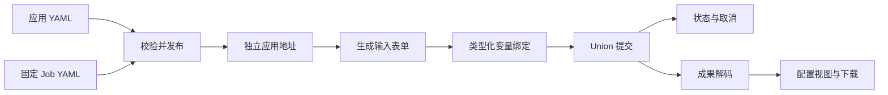

# 配置式应用开发

表格预览最多显示 10 行数据，并标明总行数与当前预览行数。完整结果下载保留全部数据行。

已发布应用统一列在主导航的“应用服务”页面（`/services/`），首页展示协作网络与数据中心。

[English](appbuilder.md) · [首页](../README_zh.md)

CONET App Builder 使用应用定义和固定的 XStream Job 发布分析应用。发布后的应用表单可以匿名浏览；开发、执行和资源管理均无需登录。Union 凭据与网络端点由 CONET 部署配置提供，不需要在浏览器中输入。

## 发布应用

1. 从门户的“应用工作台”进入 `/appbuilder/`。
2. 加载三个已发布应用之一作为模板。
3. 点击“新建应用”创建草稿，或选择现有应用后点击“编辑”。“复制应用”创建独立草稿，不影响原应用。通过“应用信息”“输入表单”“变量绑定”“结果与下载”“运行设置”标签页配置应用；通过“流程设计”打开 XStream Job Designer；“YAML 源码”同步显示配置。
4. 点击“校验配置”检查两份定义。点击“查看预览”打开上次生成的页面；如果尚未生成，则进入自动生成设置。预览窗口内可重新自动生成或重新智能生成；预览不提交任务。
5. 如需调整可在预览旁对话，确认后点击“保存并发布”。返回的 `/apps/<id>/` 链接立即生效，无需重启服务器；可以直接分享给需要运行分析的访客。

发布页是面向访客的独立应用界面，展示应用标识、参数表单、分析进度、结果视图、下载和折叠的历史记录，不包含工作台入口、YAML 编辑器或开发看板。布局适配桌面与手机，“分享应用”提供当前应用地址。

门户首页读取同一份已发布应用注册表。每张应用卡片采用配置中的名称、描述、封面和标签，直接指向 `/apps/<id>/`。发布和更新应用即可同步目录，无需编辑首页 HTML。

已发布定义在服务重启后保留。修改应用前先加载最新定义，版本校验可避免覆盖其他编辑者的更改。有排队或执行中任务的应用不能被替换。应用 ID 决定稳定的访问地址；更改 ID 会创建另一个应用。



## 可视化编辑

“应用信息”“输入表单”“变量绑定”“结果与下载”“运行设置”与“流程设计”并列显示，不再嵌套一层导航。控件类型和结果展示形式通过带图标的卡片选择，并提供样式示意。推荐顺序为：设计 Job → 配置输入表单 → 绑定变量 → 设置结果。字段和结果组件使用带图标的条目列表，选择后在单层面板中编辑，旁边提供样式示意；数值与开关使用各自的控件，不需要逐项指定数据类型。字段分组在同一面板内通过路径导航切换，不叠加配置框。结果分为“展示组件”“下载文件”和“汇总指标”；选项及指标按行编辑，数据列用逗号或换行分隔。“更多设置”收纳元数据来源和投影等专业配置；源码中的其他属性会保留。

变量列表从 Job 的完整标量引用（例如 `$MIN_SNR`）自动提取，不从注释或普通描述文字提取。变量名只读；选择表单字段、固定值、数据集 Item、上下文元数据或选区边界框作为来源。表单字段和已配置的数据集直接下拉选择。未绑定项有状态提示，Job 修改后列表同步更新。未被当前 Job 使用的旧绑定单独列出，可主动清理。允许任意编辑顺序，发布前会检查缺少的绑定及不存在的表单字段。

“流程设计”在独立窗口打开现有的 XStream Job Designer，导入当前 Job。完成后点击“应用此 Job 并返回”，将流程带回当前草稿。应用的输入表单、变量绑定与结果展示保留。切换到另一应用后，旧窗口的回传不会覆盖新草稿。浏览器须允许弹出窗口；也可下载 Job YAML 后手动导入。

部署管理员在 `conet.yaml` 配置：

```yaml
appbuilder:
  designer_url: http://10.0.82.103:8840/
  page_generation:
    codex_config: /home/cnic/.codex/config.toml
```

Designer 通过新窗口通信，校验来源、窗口和随机通道，不需要改变其禁止 iframe 嵌入的设置。

切换到“YAML 源码”会序列化当前可视化模型；切换回来会解析源码并重建模型，保留其他配置字段。可视化编辑不提交 Job，预览、校验和发布使用当前模型。

### 应用展示图片

基本信息支持填写图片 URL 或上传 PNG/JPEG 图片，最大 2 MiB、1600 万像素。上传图片保存在 `.state/appbuilder/media/`，使用基于内容摘要的地址。`presentation.cover` 接受本地资源或 HTTPS 图片地址；省略时使用公共默认图片。内置案例各有自己的示意图。`presentation.tags` 最多 8 项，每项最多 32 个字符。

```yaml
presentation:
  cover: /assets/observatory-cover.svg
  tags: [Multi-band catalogs, Color analysis]
  notice: Synthetic data demonstration.
```

## 定义文件

每个内置案例包含 `application.yaml` 和 `job.yaml`。Scala 子模块 `conet-appbuilder` 负责校验、变量绑定、Union 执行、排队、历史、取消、成果与使用统计。三个现有案例保留专业地图和天区图，复用与生成应用相同的浏览器运行库和后端。

完整示例：

- [淤地坝](../cases/check-dams/application.yaml)：多边形与置信度输入，SVG metadata 解码，地图、表格与下载。
- [天文台](../cases/observatory/application.yaml)：天区圆锥、匹配半径和信噪比输入，JSON 解码，天区与颜色散点图及 CSV。
- [应急](../cases/emergency/application.yaml)：多边形、嵌套事件字段和可用性选择，来源状态、空间结果与影响要素表。

可复制天文台定义，修改 `id` 和 `title`，保留 `data.scope: observatory`。`data.scope` 选择管理员配置的数据上下文及其 manifest；目前可选 `check-dams`、`observatory`、`emergency`。新增数据上下文需要在 CONET 配置其数据和 manifest；基于已有上下文发布新分析无需修改服务器代码。

### 输入

`inputs` 是有序列表，每项包含 `name`、`label`、`widget`，以及可选 `required`（默认 `true`）。未声明的输入字段会被拒绝。

| 控件 | 值 | 配置 |
|---|---|---|
| `number` | 有限 JSON 数字 | `min`、`max`、`default` |
| `select` | 字符串 | `options: [{value: value, label: Label}]` |
| `text` | 字符串 | `max_length`，默认 4096 |
| `datetime` | 带时区的 ISO 8601 字符串 | 浏览器表单使用 UTC |
| `polygon` | WGS84 GeoJSON Polygon 几何 | `coverage_manifest`、`initial_manifest` |
| `cone` | `[ra, dec, radius]`，单位度 | `min_radius`、`max_radius` |
| `object` | 嵌套输入对象 | `fields`；可选 `point_fields`、`coverage_manifest` |

`default` 提供服务端字面默认值。`default_manifest` 通过 JSON Pointer 从数据 manifest 取得默认值。`initial_manifest` 初始化浏览器表单，不会把必填项变成可选项。多边形输入支持天地图、逐点绘制及 GeoJSON 编辑；地图加载失败时仍能编辑坐标。多边形必须闭合、有效、非空且与配置覆盖区相交，最多 256 个顶点和 16 个环。圆锥坐标与数值范围均经过服务端校验。

### 变量绑定

每个变量必须恰好声明一个来源。名称遵循 Job 变量语法 `[A-Za-z_][A-Za-z0-9_]*`：

```yaml
variables:
  CONE: {input: cone}
  EVENT: {input: event}
  EVENT_TIME: {input: event.time}
  REGION_BBOX: {bbox: region}
  OBSERVATION_TIME: {manifest: /event_time}
  CATALOG_URI: {dataset: g-band, item: catalog.bundle}
  MODE: {value: analysis}
```

只保留 Job 需要的绑定。输入对象和数组保留 JSON 类型。`dataset` 根据 Union 目录中的上下文元数据查找数据集，再追加经过校验的相对 Item 路径。客户端不能选择凭据、文件系统输出路径或提交端点。Job 使用 `read_item@1.0` 等具名仓库算子，只提供一个输出流。

### 成果

`result.decoder` 可选 `json` 或 `svg-metadata`。后者读取 SVG 中唯一的 `<metadata>` JSON 对象，并禁用外部实体。`result.views` 支持 `metrics`、`table`、`scatter`、`geojson`。视图 `path` 和指标路径使用 JSON Pointer。表格可通过 `project` 投影嵌套对象、通过 `exclude` 排除匹配行，并声明 `columns`；最多预览 200 行。散点图配置 `x`、`y` 和可选 `reverse_x`。GeoJSON 地图支持点、线、多边形及其 Multi 几何。

`result.artifacts` 通过 `id`、`label`、`file` 和 `format`（`raw`、`json`、`csv`）声明下载。JSON 成果选择 `path`；CSV 成果选择行数组、列及可选投影和过滤。每次成功分析还生成 `analysis.json` 与 `variables.yaml`。仅成功任务的已声明成果可下载，以附件方式返回。`result.summary` 将汇总名称映射到 `{path: /field}` 或 `{path: /rows, operation: count}`。

`limits.max_queued` 限制每个应用已受理的排队/运行任务数，默认 4，最大 100。`limits.max_result_bytes` 限制结果流，默认 8 MiB，最大 64 MiB。每个应用串行处理分析。失败和取消会清除不完整成果。重启时未完成任务标记为 interrupted；再次提交前请在 Union 看板核对原任务。

## 智能页面生成连接

将 `appbuilder.page_generation.codex_config` 配置为服务端可读的 Codex TOML 文件。智能生成与预览内对话使用其中选定的 `model`、`model_provider`、提供方 `base_url` 和 `wire_api: responses`。凭据来自 `experimental_bearer_token` 或 `env_key` 指定的服务端环境变量。浏览器仅获得功能是否可用，不接收凭据。不要将凭据文件提交到仓库。模型接收应用定义、完整 Job、变量使用位置和当前对话，不接收执行数据、Token 或 CA 文件。单次请求最长 120 秒，最多两个并发请求、12 轮对话。失败时保留上次生成的草稿及已发布应用。

## 使用统计

工作台展示持久化计数，也可通过 `GET /api/appbuilder/statistics` 查询：

| 计数 | 规则 |
|---|---|
| 应用提交次数 | 每次受理提交计一次，包括随后失败或取消的任务；校验失败、队列满而被拒绝的请求不计。 |
| 数据集使用次数 | 对应 `read_item` 步骤被观察到运行或终态时，同一应用任务内每个数据集 URI 计一次。 |
| 算子调用次数 | 每个被观察到执行的步骤及其执行尝试计一次；两个步骤使用相同算子计两次。 |
| 节点接收任务次数 | 按 Union 执行记录中确认的节点身份与执行 ID 计一次；仅规划了分配不计。 |

统计范围为通过 CONET 应用提交的任务，不包含所有直接提交给 Union 的任务。事件去重后保存在任务记录中，轮询和服务重启不会增加计数。缺少执行观察数据的旧记录只计应用提交次数。节点观察使用配置中的 Union 看板；观察不可用时不会猜测接收次数。保留任务记录才能保留统计。

## 存储与 API

- `.state/appbuilder/definitions/<id>/`：已发布应用及不可变 Job 定义文件。
- `.state/appbuilder/runs/<id>/`：新发布应用的历史与成果。
- `.state/cases/<id>/`：内置应用的历史、数据与成果。

| 方法与路由 | 用途 |
|---|---|
| `GET /api/appbuilder/settings` | Designer 地址与对话助手可用状态，不含凭据 |
| `GET /api/appbuilder/apps` | 已发布应用及其地址 |
| `GET /api/appbuilder/apps/<id>` | 应用定义、Job、修订标识与地址 |
| `POST /api/appbuilder/validate` | 校验 `{application_yaml, job_yaml}`，可选 `inputs` |
| `POST /api/appbuilder/apps` | 发布同样的请求；更新时附上当前 `revision` |
| `POST /api/appbuilder/pages/generate` | 根据 `application_yaml`、`job_yaml` 和 `messages` 生成或调整页面展示配置，不发布 |
| `GET /api/appbuilder/statistics` | 使用计数 |
| `POST /api/appbuilder/convert` | 将 `{application, job}` 对象或 YAML 字符串转换为类型化 JSON 和 YAML，不发布 |
| `POST /api/appbuilder/media` | 上传 `{content_base64}` PNG/JPEG 封面 |
| `GET /apps/<id>/api/config` | 表单定义、Job 及公开数据 manifest |
| `POST /apps/<id>/api/preview` | 校验输入并查看输入变量值，不提交任务 |
| `POST /apps/<id>/api/jobs` | 提交分析输入对象 |
| `GET /apps/<id>/api/jobs[/<run-id>]` | 历史或任务状态/结果 |
| `POST /apps/<id>/api/jobs/<run-id>/cancel` | 取消排队/执行中的分析 |

开发配置请求最多 256 KiB；图片上传端点接受最多 3,000,000 字节请求，用于上传 2 MiB 图片；分析输入最多 16 KiB。跨来源修改请求会被拒绝。本阶段不设置身份认证，能访问工作台的人均可发布应用、提交和取消分析；根据部署需要限制网络暴露范围。

## 扩展成果解码

在独立 Scala/JVM 插件中实现 `conet.appbuilder.ResultDecoder`，提供唯一 `id` 与 `decode(bytes): JsonNode`。在 `META-INF/services/conet.appbuilder.ResultDecoder` 登记实现类全名，将 JAR 和依赖加入 CONET 运行时 classpath，并重启服务。配置 `result.decoder` 为插件 ID。内置和外部解码器采用相同的 ServiceLoader 契约，无需修改集中注册表。契约测试应覆盖无效载荷、受限输出及供配置视图使用的 JSON 文档。

嵌入页面的自定义浏览器成果组件可使用 `ConetAppBuilder.registerView(type, renderer)`。托管编辑器目前校验四种内置视图类型。数据生成和领域算法独立于应用构建器。

## 构建与验证

```bash
sbt -batch 'appbuilder/test' 'hosting/test' test stage
bin/conet restart-web
python3 scripts/smoke_web.py
python3 scripts/smoke_appbuilder.py
python3 scripts/smoke_appbuilder.py
python3 scripts/smoke_appbuilder_browser.py --chromium /path/to/chromium
```

重启命令仅更新门户及应用 HTTP 服务，保留运行中的数据节点和 Union。


## 分析产品

参阅[发布和分享分析产品](products_zh.md)，了解结果自动说明、多方署名与许可、独立分享页、存储、到期和撤回。

[工作空间与共享托管](workspaces_zh.md)

## 应用交付与文件输入

先设计流程，再配置表单、变量绑定和结果视图。应用以可导入导出的[应用程序包](application-packages_zh.md)交付。[文件输入](file-inputs_zh.md)将受限浏览器上传绑定到独立运行的 DACP Item。`examples/uploaded-csv/` 提供 CSV 预览、字段统计和下载。CONET 包含八个 Node 成员：七个科学数据中心与一个共享托管中心，由单独的 Union 协调。

## 应用界面主题

在预览的“重新自动生成”页面设置环节通过五张页面缩略预览卡片选择界面主题，或在 YAML 中设置 `presentation.theme`。可选 `coast`（海湾青）、`forest`（山野绿）、`indigo`（星空靛）、`amber`（暖阳金）和 `rose`（珊瑚红），默认 `coast`。主题统一调整页面背景、标题、标记、按钮和下载入口，随应用程序包保存。淤地坝、天文和应急示例分别使用山野绿、星空靛和暖阳金。所有发布应用统一使用 `/apps/<id>/`；旧案例专用页面和独立 HTTP 监听入口不提供服务。

## 发布页面展示

应用页面用配置的封面和标签展示应用场景，随后显示输入、执行状态和结果。在较大屏幕中，多边形选区和参数并列展示。主题作用于标题、表单强调色、状态区域和下载入口。提交分析或显式打开已有运行之前，结果区保持空白。页面可独立分享，不包含应用设计导航。

## 背景图与外观推荐

在“应用信息”中编辑名称、描述和标签后，打开“查看预览”，在自动生成的设置窗口查看推荐的主题、背景图及缩略图。推荐通过主题关键词和输入能力匹配内置视觉方案，不会将描述发送到模型，也不生成照片。“应用整套推荐”仅修改草稿；预览并调整各图片后，再发布应用。

背景图库提供“跟随主题”“无背景”和五张内置背景。也可上传 PNG/JPEG 图片（每张不超过 2 MiB），或填写 HTTPS 图片地址。缩略图用于应用卡片及介绍区，背景图用于发布页面，可读的内容区域显示在其上。

```yaml
presentation:
  theme: indigo
  background: /assets/background-indigo.svg
  cover: /assets/observatory-cover.svg
  tags: [Multiband catalogs, Color analysis]
```

省略 `background` 时跟随主题，设置 `background: null` 时使用纯色背景。导出应用程序包时，会嵌入上传的背景图和缩略图；HTTPS 图片保留外部地址，须能公开访问。

发布页面根据输入类型布局：地图保留宽选区，文件类应用的参数与结果并列。ICRS 选区提供坐标示意及缩放；结果表格提供限量滚动预览；散点图提供坐标轴、缩放/复位和悬停读数。地理底图连接失败时，地图明确显示经纬度选区视图，不将坐标示意冒充地理影像。

“开始分析”在请求提交、排队及执行期间保持禁用，完成、失败、超时或取消后恢复。状态查询暂时失败时，按钮仍保持禁用，客户端继续重试查询。

## 全局分析准入与资源限制

在 `conet.yaml` 中配置 Web 进程（不放入各应用程序包）：

```yaml
appbuilder:
  execution:
    max_running: 2
    max_queued: 16
    min_free_bytes: 1073741824
```

以上默认值允许所有应用合计两个活动分析、十六个等待分析。每个应用仍最多同时执行一个分析；应用自身的 `limits.max_queued` 限制该应用运行中与等待中的任务总数。全局队列会跳过已有任务运行的应用，让其他应用使用空闲执行槽位。全局队列设为零时，只接受能立即开始的任务。同一个 CONET Web 进程中的并发提交共享同步准入检查。

队列已满返回 HTTP 429，不创建分析记录。磁盘空间不足或无法检查空间返回 HTTP 507。服务器在接收任务、启动排队任务和写入结果前检查分析存储所在文件系统的可用空间。排队任务启动时若空间不足，会记录为失败，不向后端提交 Job。取消排队任务会立即释放排队名额；失败或取消的活动任务在清理后释放执行槽位。服务关闭时拒绝新任务并取消活动分析。关闭浏览器不会取消已接收的分析。修改部署配置后，应等待当前分析完成再重启 Web 服务。

磁盘阈值是余量检查，不是空间预留或单任务配额，其他写入仍可能耗尽空间。这些限制覆盖单个 Web 进程的 App Builder 提交，不覆盖直接向 DACP/Union 提交的任务、多个 CONET 进程、文件上传及已完成产品长期占用的存储。执行节点的 CPU、内存、容器和并发限制需另行配置；一个分析槽位不代表预留固定节点资源。应用的 `max_result_bytes` 限制返回成果，不限制处理中间内存。

## 生成、预览和发布应用页面

完成流程、输入表单、变量绑定和结果配置后，点击**自动生成**，按结构化的表单、结果和外观配置生成页面；点击**智能生成**，结合任务含义和配置的变量设计页面。自动生成使用 `presentation.design`（`layout`、`hero`、`surface`、`density`）及主题，不沿用上一次模型设计。智能生成读取完整 Job 及变量使用位置。智能生成每次可以选择不同的布局、标题区域、面板外观、紧凑程度、强调色和介绍文案。模型连接来自服务端 `appbuilder.page_generation.codex_config`，凭据不会发送到浏览器。

智能生成根据任务、输入表单和结果内容独立设计，不受“页面设置”限制。首次生成不会向模型发送已配置的布局、主题、背景、封面和旧页面；生成页面使用自己的主题、背景和封面，展示时优先于页面设置。原页面设置保留给自动生成使用；对话调整以当前生成页面为基础。

两种方式均弹出大窗口预览，显示实际配置的输入控件与初始结果区域，预览不能提交分析。预览工具栏提供“重新自动生成”“重新智能生成”，支持反复生成。UNDO / REDO 可撤销和重做最近 20 个预览版本，新修改会清空重做记录。关闭再打开会保留当前预览和对话。在预览旁的对话框中描述布局、配色或文案调整要求，回复如包含修改建议，会显示“立即更新”；点击后才应用到预览和草稿。发送对话时，等待提示仅显示在发送按钮上，左侧预览不遮挡、不重新加载，并保留当前填写内容；收到修改建议也不会自动刷新。仅回答问题时不刷新界面。撤销、重做或重新生成后，旧建议不能再应用。生成过程不会修改 Job、输入定义、变量绑定、数据范围和结果契约。配置改变后，旧预览不能发布，需重新生成。

点击**保存并发布**，保存当前已预览的页面，并沿用已有版本冲突检查。经过校验的 `presentation.page` 随应用程序包导入导出，保持确认后的外观。支持字段包括 `layout`（`split`、`stacked`、`wide`）、`hero`（`banner`、`compact`、`centered`）、`surface`（`soft`、`outlined`、`elevated`）、`density`（`comfortable`、`compact`）、六位十六进制颜色 `accent`、80 字符以内的 `heading`、400 字符以内的 `intro`。页面还支持独立的 `theme`、`background` 和 `cover`；图片可为空或 `/assets/` 下的本地资源。不接受模型生成的可执行 HTML、脚本或样式。模型请求失败时保留草稿和已发布应用；未配置模型也可以自动生成。

生成页面还可包含 `input_labels`（输入路径到显示名称，最多 80 字符）、`input_hints`（输入路径到填写帮助，最多 240 字符）、`input_order`（包含全部顶层输入名称的排列）。嵌套路径用点连接，仅允许引用已声明的输入；字段名称、控件类型、范围、变量绑定和结果契约保持不变。预览内对话可提出这些展示字段及布局的修改建议，点击“立即更新”后应用。“查看预览”重新打开当前界面，不再次生成。修改结构化配置后，需重新生成再发布。

预览右侧的对话边栏可通过“收起对话 / 展开对话”切换；收起后预览占满宽度。程序包导出入口位于应用概览，不在编辑界面。

## 数据集与应用评分

应用服务列表、独立 App 页面、数据集列表及详情提供 1–5 分评分，展示平均分和次数。同一浏览器再次评分会替换已有分数，不增加次数。浏览器通过 HttpOnly Cookie 区分，无需登录；清理 Cookie 或更换浏览器后会被视为新的评分来源。评分独立保存在 `.state/ratings.json`，不写入 App 配置或 DACP 数据集元数据。备份运行状态时同时备份此文件。

`GET /api/ratings/app`、`GET /api/ratings/dataset` 返回汇总及当前浏览器的评分；`POST /api/ratings` 接收 `kind`（`app`/`dataset`）、已存在对象的 `id` 和整数 `score`（1–5）。写入采用原子替换，服务重启后保留评分。

自动生成包含独立的设置环节：首次点击“查看预览”或在预览中点击“重新自动生成”，调整主题、布局、标题区域、面板样式、间距、背景与缩略图，再点击“生成并预览”。取消会丢弃本次设置。应用信息只维护名称、介绍与标签；智能生成直接设计页面，不经过此设置环节。

编辑栏仅提供“校验配置”“查看预览”“结束编辑”。“查看预览”优先恢复本次编辑会话上次生成的界面，也支持打开应用配置中已保存的页面；没有生成页面时进入自动生成设置。重新自动生成、重新智能生成和对话调整均在预览窗口内操作。

## 应用上线、下线与删除

在应用概览中选择“下线”可停止对外提供应用页面和新分析提交，并从首页及应用服务列表隐藏。下线后仍可编辑和导出程序包，按钮变为“上线发布”，可恢复服务。已受理的分析继续执行，分析历史、结果文件及已发布的数据集保留。

“删除”需在站内确认窗口中确认；有运行或排队分析时拒绝删除。删除后从管理列表移除并停用应用；保留定义归档、历史与成果，不支持在界面撤销，原应用标识不能复用。状态保存在 `.state/appbuilder/lifecycle.json`，重启后保持。

管理 API：`POST /api/appbuilder/apps/<id>/status` 接收 `{status: online|offline, revision: <当前版本>}`；`POST /api/appbuilder/apps/<id>/delete` 接收 `{revision: <当前版本>}`。两者校验请求来源及版本。公开页面和新任务对下线或已删除应用返回 HTTP 410，已有任务记录和成果接口继续可用。

“应用信息”不再提供数据上下文选择项；程序包中已有的 `data.scope` 和默认值元数据依赖会保留，避免影响现有分析。
