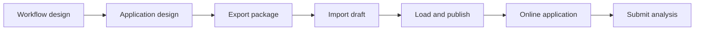

# Application packages

A CONET application package (`*.conet.zip`) is the portable delivery unit for an application. It contains its input form, variable bindings, result presentation and fixed XStream Job. Import it into App Builder, review its dependencies, then choose **Load and publish**. Loading registers the application and immediately provides `/apps/<id>/`; users submit analysis from that address. Import alone creates an editable draft and does not execute a Job or publish an application.



## Contents

```text
application.conet.zip
├── manifest.json
├── application.yaml
├── job.yaml
└── cover.png or cover.jpg  (optional)
```

The manifest uses `format: conet-application` and `version: 1`. CONET exports the referenced operator versions and optional `data_scope` as dependency information. The Job reference inside `application.yaml` is `job.yaml`. Custom uploaded PNG/JPEG covers are embedded and restored during import. Standard `/assets/` covers and HTTPS covers retain their URL references. A package does not bundle datasets, uploaded inputs, run history, results, operator binaries, runtimes, service credentials or model API settings.

The destination must provide referenced operators and the required execution environments. Dataset/manifest bindings require a locally configured `data.scope`, and explicit remote URIs must be reachable. An upload-only application can omit `data.scope`. File uploads require the shared hosted node. Loading validates the configured data context and application definition; actual operator availability and data permissions are checked by the execution service when analysis runs.

## App Builder

- **Import application package** opens its draft with workflow design first, followed by application design and YAML source. The redundant four-step guide is omitted.
- **Export package** in the editor exports the validated draft. The overview export link downloads the currently loaded version.
- **Load and publish** saves a revision-checked definition and exposes its online page; it does not automatically run analysis.
- When an imported ID already exists, the editor explicitly states that loading will update that application. The revision is checked again when loading. Duplicate the application to keep both versions.

Packages are limited to 4 MiB compressed and expanded, with at most the five explicitly supported filenames. Application, Job and manifest files are each limited to 256 KiB, covers to 2 MiB. Unknown entries, duplicate names, traversal paths, missing files and invalid definitions are rejected. Entries are read into bounded buffers and never extracted into arbitrary filesystem paths. Import does not execute package contents.

## API and command

| Endpoint | Purpose |
|---|---|
| `POST /api/appbuilder/packages/import` | Raw ZIP with `application/octet-stream`; returns an unpublished draft |
| `POST /api/appbuilder/packages/export` | JSON `application_yaml` and `job_yaml`; returns a ZIP |
| `GET /api/appbuilder/packages/<id>` | Export the currently loaded application |
| `POST /api/appbuilder/apps` | Load/publish the reviewed draft with its revision when updating |

```bash
python3 scripts/build_application_package.py examples/uploaded-csv /tmp/uploaded-csv.conet.zip
```

Import the ZIP through App Builder. Use [file inputs](file-inputs.md) for upload configuration and the ready-to-run CSV example. The helper packages `application.yaml` and `job.yaml`; use App Builder export to embed custom uploaded cover resources.
