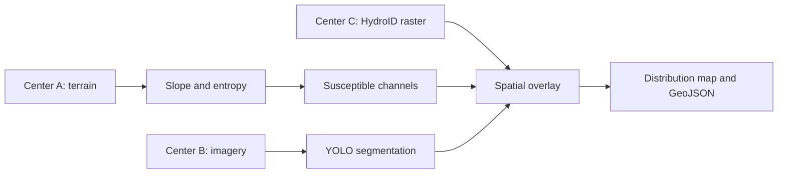
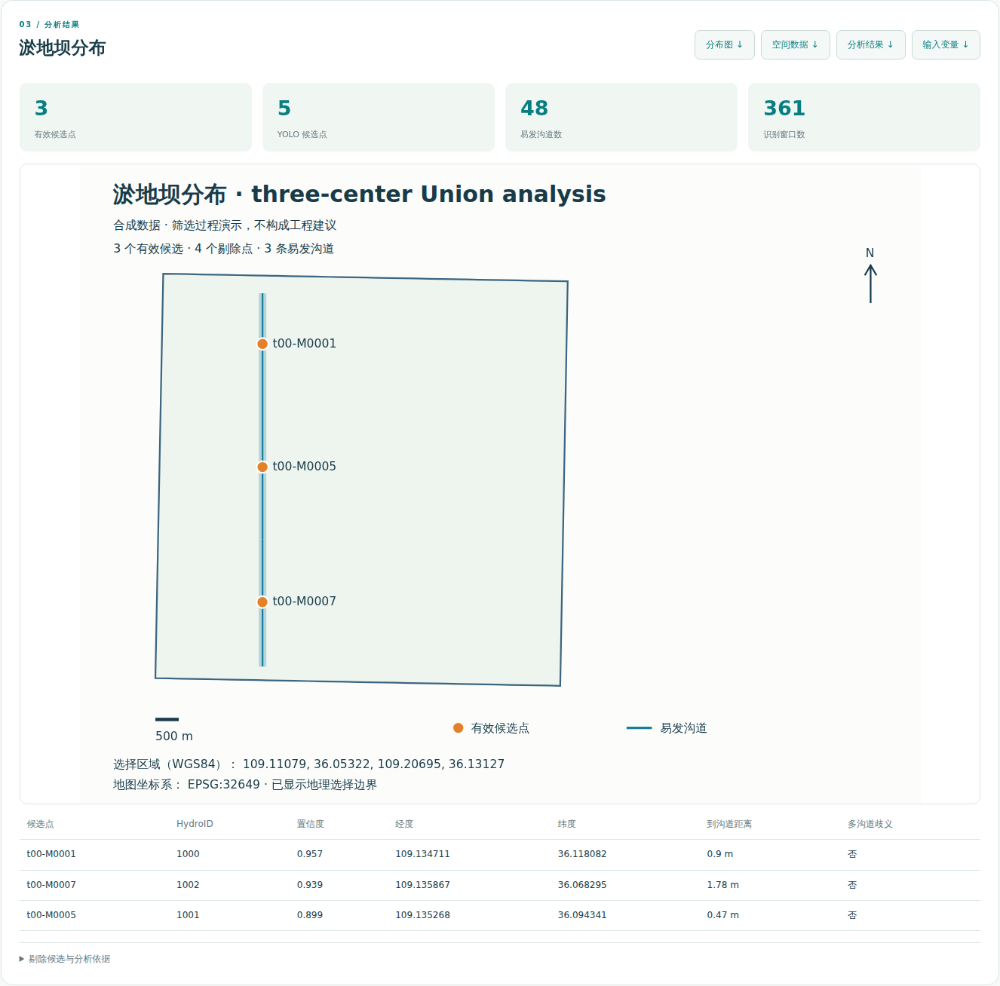
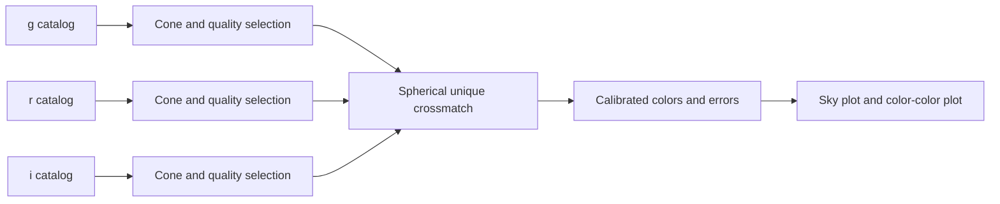
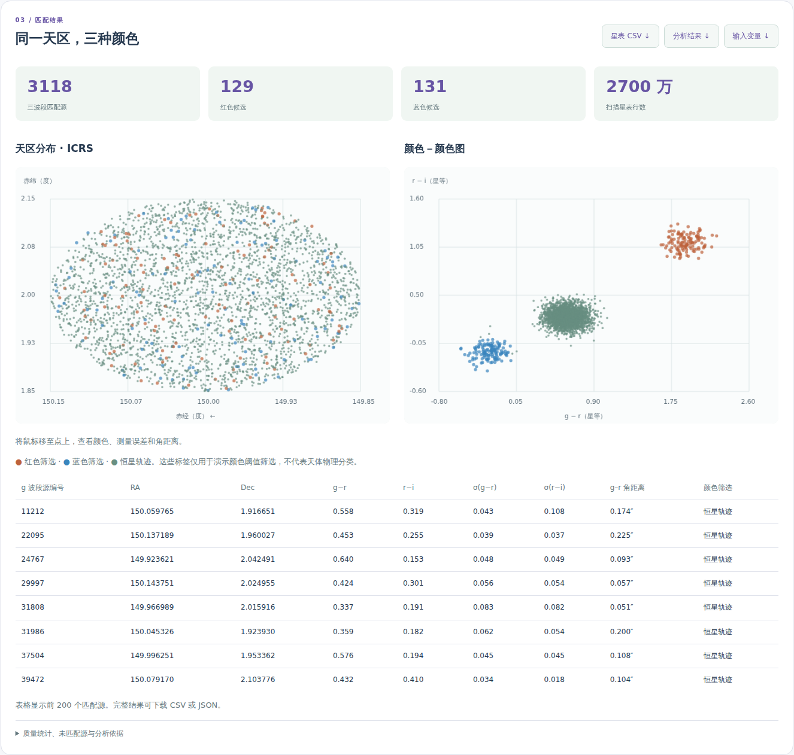

# Scientific cases

[中文](cases_zh.md) · [Home](../README.md)

## 1. Check dams within susceptible gullies

This case identifies **existing synthetic check-dam structures** within susceptible gullies. It does not design new dam sites. Select a required WGS84 bounding box `[west, south, east, north]`; the fixed [`job.yaml`](../cases/check-dams/job.yaml) supplies the processing graph and input variables. The Web backend discovers source dataset URIs from the Union catalog.

| Center | Data | Approximate volume |
|---|---|---:|
| A | DEM, catchments, complete channel geometry/topology | 265 MiB |
| B | RGB imagery and georeferencing control information | 530 MiB |
| C | HydroID channel rasters | 177 MiB |

The diagram represents data dependencies. Union chooses execution locations; the node publishing a dataset does not necessarily run the final overlay.

### Algorithms and defaults

1. **Gully slope:** `(upstream elevation − downstream elevation) / along-channel planar length`. It is a ratio, not an angle; 0.08 represents 8%.
2. **Geomorphic entropy:** normalized Shannon entropy of 16 equally spaced elevation bins per complete synthetic tile basin, `H = −Σ pᵢ ln(pᵢ) / ln(16)`. Constant elevation gives zero. This implementation is a reproducible demonstration metric, not a validated regional geomorphic model.
3. **Susceptibility:** seed slope 0.08–0.50 and entropy `< 0.2`; follow `NextDownID` up to 32 downstream hops, stopping at missing nodes/outlets and rejecting cycles. Analysis retains full topology/basin context; map geometries are clipped to the requested box.
4. **Detection:** real YOLO11n segmentation trained on synthetic dam motifs; 128-pixel windows, stride 96, confidence default 0.35, georeferencing checks, duplicate merging within 60 m.
5. **Overlay:** project detections to the HydroID raster and inspect a 7×7 neighborhood (`bias=3`). Select the nearest nonzero HydroID, mark multi-ID ambiguity, and accept only when that nearest ID belongs to the susceptible set. A non-nearest susceptible ID does not override the nearest ID.

The trained model is fixed between requests. Parameters and region selection change; the workflow definition does not. Sources stream as bounded members; source archives are currently fully consumed, not remotely indexed by region. Intermediate JSON has an 8 MiB bound. Raster members are limited to 48 MiB and three million cells. The final application stores results; this is distinct from intermediate workflow materialization.

### Results

- `distribution.svg`: distribution map containing JSON analysis metadata.
- `sites.geojson`: accepted candidate coordinates and provenance properties.
- `analysis.json`: candidates, rejection reasons, HydroIDs, metrics, model and parameters.
- `variables.yaml`: resolved variables used for this submission.

## 2. Three-observatory crossmatching and colors

Three fictional observatories provide g/r/i catalogs. Each has nine million rows split into 18 FITS shards, including source coordinates, flux, uncertainty and quality. Source IDs are synthetic audit labels, **not matching keys**.

The fixed [`job.yaml`](../cases/observatory/job.yaml) uses `CONE = [RA, Dec, radius]` in ICRS degrees (default `[150, 2, 0.15]`), `MATCH_RADIUS_ARCSEC` (default 0.8) and `MIN_SNR` (default 5). The supported cone radius is 0.001–1 degree, with at most 50,000 selected sources per band.

Selection rejects bad quality, non-finite or nonpositive flux/error and low SNR. Magnitudes use `MAGZP − 2.5 log10(FLUX) + ZPCORR`; uncertainty is `(2.5/ln(10)) × FLUX_ERR/FLUX`. Matching uses ICRS spherical geometry and rejects multiple alternatives. All g–r, g–i and r–i pairwise separations must satisfy the matching radius.

Colors are `g−r` and `r−i`; their errors are quadrature sums. Illustrative red selection uses `g−r ≥ 1.5` and `r−i ≥ 0.8`; blue uses both colors `≤ 0`; other points are labeled stellar locus. These are display cuts, not astrophysical classifications. Catalogs are scanned in full; this implementation has no indexed remote cone reads.

The Web interface displays a sky plot, color–color plot, hover inspection and first-200-row table. Complete matches are downloadable as `matches.csv` and `analysis.json`, together with `variables.yaml`.

