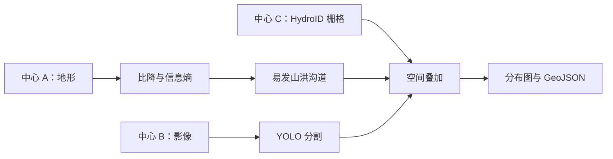
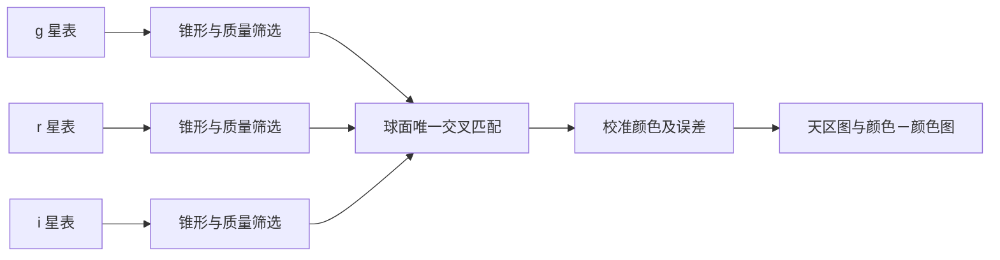

# 科学案例

[English](cases.md) · [首页](../README_zh.md)

## 1. 易发山洪沟道内的淤地坝识别

本案例识别易发沟道中的**已有合成淤地坝结构**，不用于新坝工程选址。必须输入 WGS84 空间选择框 `[west, south, east, north]`；固定的 [`job.yaml`](../cases/check-dams/job.yaml) 提供处理图及输入变量。Web 后端从 Union 目录发现源数据集 URI。

| 中心 | 数据 | 约计数据量 |
|---|---|---:|
| A | 高程、集水区、完整沟道几何与拓扑 | 265 MiB |
| B | RGB 遥感影像与地理参考控制信息 | 530 MiB |
| C | HydroID 沟道栅格 | 177 MiB |

图示表达数据依赖。执行位置由 Union 选择，发布某数据集的节点不一定执行最终空间叠加。

### 算法与默认值

1. **沟道比降：**`（上游高程－下游高程）/ 沟道平面长度`。结果是比值而非角度，0.08 表示 8%。
2. **地貌信息熵：**对每个完整合成瓦片流域中的高程进行 16 个等宽分箱，计算归一化香农熵 `H = −Σ pᵢ ln(pᵢ) / ln(16)`；高程恒定时为零。这是可复现的演示指标，并非已验证的区域地貌模型。
3. **易发沟道：**种子比降 0.08–0.50、信息熵 `< 0.2`；沿 `NextDownID` 向下游追溯最多 32 跳，遇缺失节点或出口停止，检测到环则报错。分析保留完整拓扑和流域上下文，地图几何再按选择框裁切。
4. **目标识别：**使用在合成坝体图案上训练的真实 YOLO11n 分割模型；窗口 128 像素、步长 96、默认置信度 0.35，校验地理参考并合并 60 米内重复检测。
5. **空间叠加：**把检测点投影至 HydroID 栅格，在 7×7 邻域（`bias=3`）寻找最近的非零 HydroID。多个 ID 时记录歧义，仅当最近 ID 属于易发集合时接纳。不会因其他较远 ID 属于易发集合而覆盖最近 ID。

训练模型在请求间保持固定。参数和选择区域变化，工作流定义不变。源数据按有限大小成员流式处理；目前仍须完整消费源归档，不支持按区域索引远程读取。中间 JSON 上限 8 MiB，栅格成员上限 48 MiB、三百万像元。最终应用会保存结果，这与工作流中间结果物化不同。

### 成果

- `distribution.svg`：包含 JSON 分析元数据的分布图。
- `sites.geojson`：通过筛选的候选坐标及依据属性。
- `analysis.json`：候选、剔除原因、HydroID、指标、模型和参数。
- `variables.yaml`：本次提交采用的已解析变量。

## 2. 三天文台交叉匹配与颜色分析

三个虚构天文台提供 g/r/i 星表，每个星表 900 万行、分为 18 个 FITS 分片，包含坐标、流量、误差和质量。合成源编号仅用于追溯，**不作为匹配依据**。

固定的 [`job.yaml`](../cases/observatory/job.yaml) 使用 ICRS 度单位的 `CONE = [RA, Dec, radius]`，默认 `[150, 2, 0.15]`；`MATCH_RADIUS_ARCSEC` 默认 0.8；`MIN_SNR` 默认 5。锥形半径范围为 0.001–1 度，每个波段最多选出 50,000 个源。

筛选排除质量不合格、流量或误差非有限/非正以及信噪比过低的记录。星等为 `MAGZP − 2.5 log10(FLUX) + ZPCORR`，误差为 `(2.5/ln(10)) × FLUX_ERR/FLUX`。匹配使用 ICRS 球面几何，拒绝存在多个备选的歧义关系；g–r、g–i、r–i 三对角距离均须满足半径要求。

颜色为 `g−r`、`r−i`，误差按平方和开根号传播。演示红色筛选条件为 `g−r ≥ 1.5` 且 `r−i ≥ 0.8`；蓝色为两项均 `≤ 0`；其余标记为恒星轨迹。这些是展示阈值，不是天体物理分类。当前须完整扫描星表，不支持基于索引的远程锥形读取。

Web 展示天区图、颜色－颜色图、鼠标悬停详情和前 200 行表格。完整匹配可下载 `matches.csv`、`analysis.json`，并附带 `variables.yaml`。

