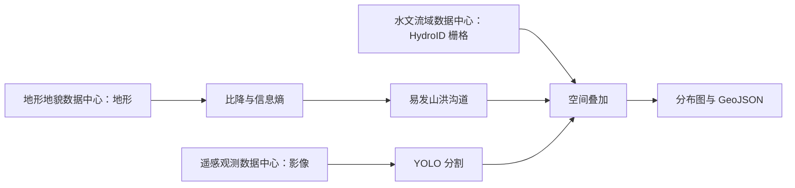
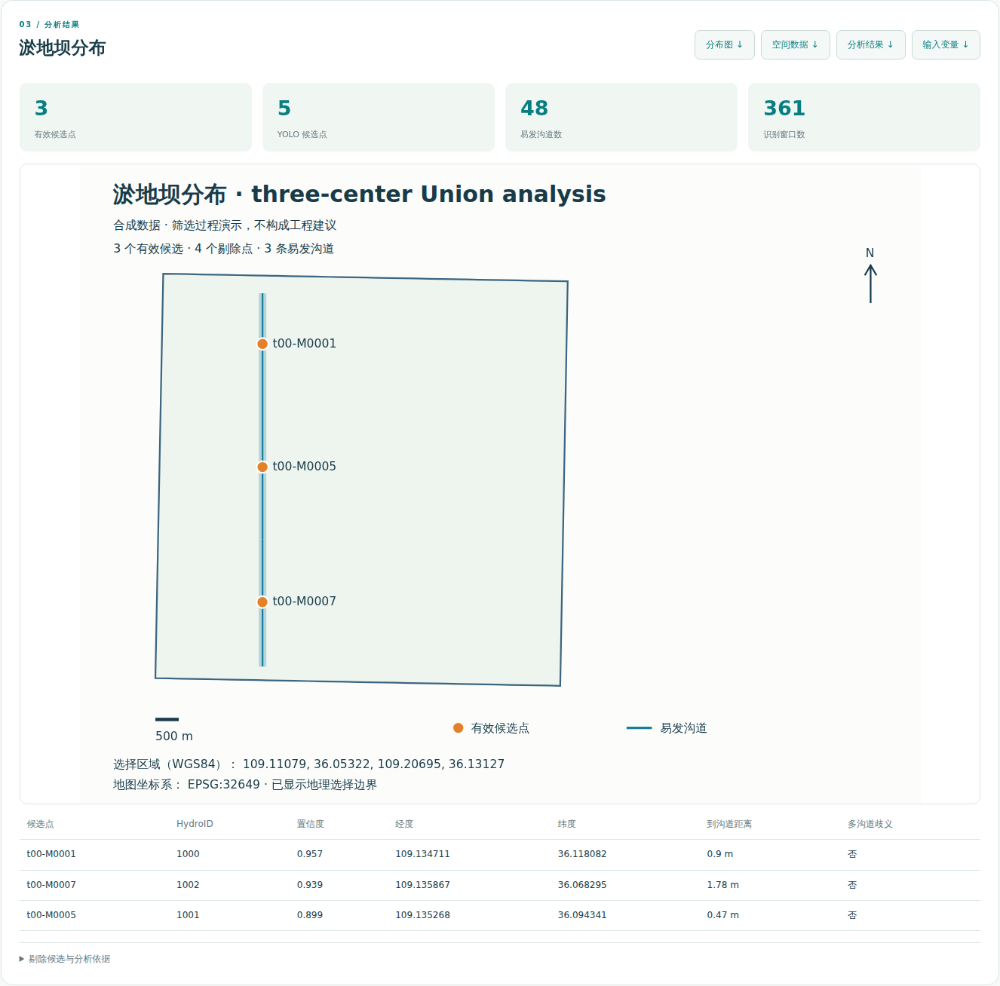
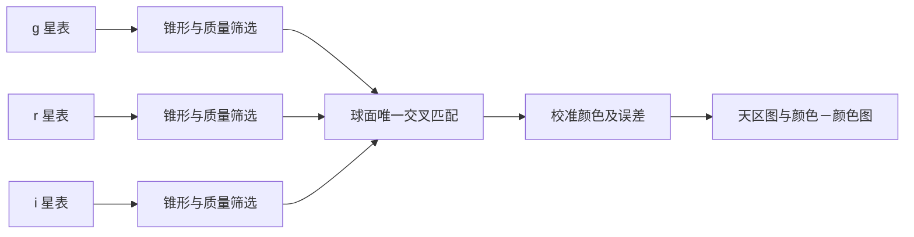
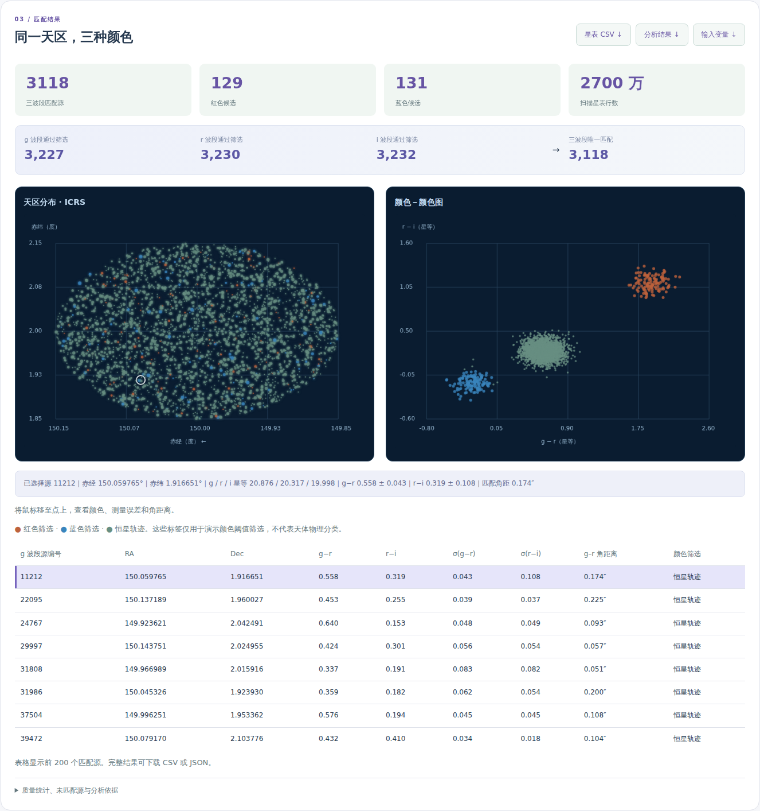

# 科学案例

[English](cases.md) · [首页](../README_zh.md)

## 1. 易发山洪沟道内的淤地坝识别

本案例识别易发沟道中的**已有合成淤地坝结构**，不用于新坝工程选址。必须输入 WGS84 空间选择框 `[west, south, east, north]`；固定的 [`job.yaml`](../cases/check-dams/job.yaml) 提供处理图及输入变量。Web 后端从 Union 目录发现源数据集 URI。

| 中心 | 数据 | 约计数据量 |
|---|---|---:|
| 地形地貌数据中心 | 高程、集水区、完整沟道几何与拓扑 | 265 MiB |
| 遥感观测数据中心 | RGB 遥感影像与地理参考控制信息 | 530 MiB |
| 水文流域数据中心 | HydroID 沟道栅格 | 177 MiB |



图示表达数据依赖。执行位置由 Union 选择，发布某数据集的节点不一定执行最终空间叠加。

### 算法与默认值

1. **沟道比降：**`（上游高程－下游高程）/ 沟道平面长度`。结果是比值而非角度，0.08 表示 8%。
2. **地貌信息熵：**对每个完整合成瓦片流域中的高程进行 16 个等宽分箱，计算归一化香农熵 `H = −Σ pᵢ ln(pᵢ) / ln(16)`；高程恒定时为零。这是可复现的演示指标，并非已验证的区域地貌模型。
3. **易发沟道：**种子比降 0.08–0.50、信息熵 `< 0.2`；沿 `NextDownID` 向下游追溯最多 32 跳，遇缺失节点或出口停止，检测到环则报错。分析保留完整拓扑和流域上下文，地图几何再按选择框裁切。
4. **目标识别：**使用在合成坝体图案上训练的真实 YOLO11n 分割模型；窗口 128 像素、步长 96、默认置信度 0.35，校验地理参考并合并 60 米内重复检测。
5. **空间叠加：**把检测点投影至 HydroID 栅格，在 7×7 邻域（`bias=3`）寻找最近的非零 HydroID。多个 ID 时记录歧义，仅当最近 ID 属于易发集合时接纳。不会因其他较远 ID 属于易发集合而覆盖最近 ID。

训练模型在请求间保持固定。参数和选择区域变化，工作流定义不变。源数据按有限大小成员流式处理；目前仍须完整消费源归档，不支持按区域索引远程读取。中间 JSON 上限 8 MiB，栅格成员上限 48 MiB、三百万像元。最终应用会保存结果，这与工作流中间结果物化不同。

### 成果

- `distribution.svg`：包含 JSON 分析元数据的分布图。
- `sites.geojson`：通过筛选的候选坐标及依据属性。
- `analysis.json`：候选、剔除原因、HydroID、指标、模型和参数。
- `variables.yaml`：本次提交采用的已解析变量。



## 2. 三天文台交叉匹配与颜色分析

三个虚构天文台提供 g/r/i 星表，每个星表 900 万行、分为 18 个 FITS 分片，包含坐标、流量、误差和质量。合成源编号仅用于追溯，**不作为匹配依据**。

固定的 [`job.yaml`](../cases/observatory/job.yaml) 使用 ICRS 度单位的 `CONE = [RA, Dec, radius]`，默认 `[150, 2, 0.15]`；`MATCH_RADIUS_ARCSEC` 默认 0.8；`MIN_SNR` 默认 5。锥形半径范围为 0.001–1 度，每个波段最多选出 50,000 个源。



筛选排除质量不合格、流量或误差非有限/非正以及信噪比过低的记录。星等为 `MAGZP − 2.5 log10(FLUX) + ZPCORR`，误差为 `(2.5/ln(10)) × FLUX_ERR/FLUX`。匹配使用 ICRS 球面几何，拒绝存在多个备选的歧义关系；g–r、g–i、r–i 三对角距离均须满足半径要求。

颜色为 `g−r`、`r−i`，误差按平方和开根号传播。演示红色筛选条件为 `g−r ≥ 1.5` 且 `r−i ≥ 0.8`；蓝色为两项均 `≤ 0`；其余标记为恒星轨迹。这些是展示阈值，不是天体物理分类。当前须完整扫描星表，不支持基于索引的远程锥形读取。

Web 展示天区图、颜色－颜色图、鼠标悬停详情和前 200 行表格。完整匹配可下载 `matches.csv`、`analysis.json`，并附带 `variables.yaml`。



## 交互可视化

淤地坝 Web 地图展示由实际合成 RGB 影像和 DEM 输入生成、重投影后的离线地理预览（选择器使用 WGS84，成果地图使用 Web Mercator）。支持影像/地形切换、滚轮及按钮缩放、拖动平移、沟道/候选图层开关、点击候选点或表格查看详情，以及将当前地图导出为 PNG。区域选择器也显示影像预览。预览保存在 `.state/cases/check-dams/visuals/`，应用启动时生成一次，输入文件大小或时间戳变化后重新生成；它们仅用于展示，不改变分析、执行和调度。无需外部瓦片服务器。合成平台地形和图案不代表真实山川或卫星影像；下载的 SVG 仍为分析示意成果。

天文图在深色坐标网格上展示实际匹配源，星点大小反映合成 g 星等。在任一图或表格中选择源，可在两个图中联动高亮，并查看测光和匹配详情。完成分析后，选择地图也显示匹配源位置，不添加虚构的巡天背景。

### 公开地理底图

淤地坝结果地图另提供覆盖所选黄土高原研究区的 OpenStreetMap 图层。这是**真实地理背景**；沟道几何、坝体候选和科学分析结果仍为合成数据。图层仅请求当前可见的 `https://tile.openstreetmap.org/{z}/{x}/{y}.png` 标准瓦片，使用有上限的内存缓存，不预取或打包离线瓦片。页面标注 [OpenStreetMap 来源](https://www.openstreetmap.org/copyright)，PNG 导出也包含署名。使用条件见[瓦片使用政策](https://operations.osmfoundation.org/policies/tiles/)。公开瓦片要求浏览器可联网；本地合成影像/地形图层无需联网即可使用。公开图层的坐标、平移和锚点缩放采用墨卡托投影。

区域选择器使用真实的 OpenStreetMap 地理底图，在可用数据覆盖范围内叠加合成沟道和选择框。瓦片通过案例服务按需获取，本地缓存七天，不预下载区域地图；页面保留来源署名。外部地图服务不可达时会显示明确提示。

选择器默认选中并展示黄河区域示意矩形（东经 95–120°、北纬 32–42°），不代表权威流域边界。平移模式支持拖动，滚轮和加减按钮支持缩放，双击放大；切换框选模式可绘制选择框。“数据覆盖区”按钮选择并定位已有数据范围。分析仅使用选择范围与现有合成数据的交集，扩大选区不会增加数据。

### 多边形精确选区

点击 **多边形**，依次单击至少三个顶点，再点击 **完成绘制**。**编辑顶点** 可拖动已有顶点；**撤销顶点** 删除最近的草稿顶点，Escape 取消草稿。经纬度输入显示外接矩形，修改这些输入会将选区重设为矩形。矩形同样以 Polygon 提交。

HTTP 请求接收 `region`（WGS84 GeoJSON Polygon 几何）和 `min_confidence`。服务验证闭合环、有限经纬度、正面积、自相交以及与数据覆盖区的相交关系。最多接收 16 个环、合计 256 个坐标。API 支持孔洞，界面绘制一个外环。不支持跨越反经线的选区。无效多边形会被拒绝，不会悄悄改成外接矩形。

```json
{"region":{"type":"Polygon","coordinates":[[[109.12,36.06],[109.19,36.06],[109.12,36.12],[109.12,36.06]]]},"min_confidence":0.35}
```

固定 Job 接收 `REGION` 和派生的 `REGION_BBOX`。外接矩形缩小影像瓦片和窗口候选范围，精确多边形相交进一步筛选窗口，点与多边形的包含关系过滤检测结果；空间叠加再次独立检查每个候选点。外环及孔洞边界上的点保留，孔洞内部的点排除。完整地形流域和沟道拓扑仍用于信息熵及上下游追踪，仅展示的沟道几何会被裁剪，避免选区截断科学计算上下文。结果和下载元数据保留原多边形，两个地图视图均绘制实际边界环。本地算子使用 `1.1` 版本。
