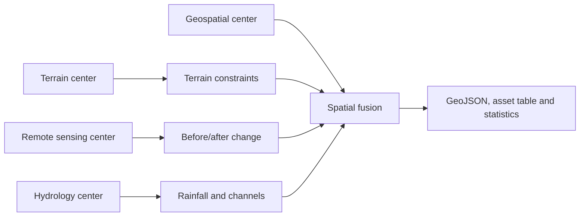

# Emergency response: multi-center data fusion

[中文](emergency_zh.md) · [Home](../README.md)

Open `/apps/emergency/` in the CONET portal. The interface is Chinese. Choose an earthquake or mudslide template, draw a rectangle/polygon, set the event location/time and submit an analysis. Results remain empty until a job completes or a user explicitly selects a historical result.

## Data and execution

The reproducible seed is `20261107`. Default generation creates **1,004,268,424 bytes** of synthetic source data: 16 tiles, 1,400 × 1,400 pixels per tile at 10 m resolution, covering approximately 56 × 56 km in EPSG:32648. Positions are an illustrative Sichuan region; the default event is 2026-08-14 08:00 UTC.

| Center | Dataset | Contents |
|---|---|---|
| Terrain and Geomorphology | emergency-terrain | Elevation and slope GeoTIFFs |
| Remote Sensing | emergency-imagery | Before/after green and near-infrared GeoTIFFs |
| Hydrology and Watershed | emergency-hydrology | Rainfall baseline and channel-distance GeoTIFFs |
| Geospatial | emergency-exposure | 58 roads and 180 settlement/facility features |

The fixed [Job](../cases/emergency/job.yaml) is expanded with `REGION`, `EVENT`, `SIMULATION`, `CHANGE_THRESHOLD` and catalog-resolved source URIs. Union assigns work to the four source nodes. The operators reuse `xstream/check-dams-demo:1.0`; no new model training is needed. Inputs and intermediate results flow through streams; only the final downloadable artifacts are saved.



## Illustrative methods

Analysis cells are 500 m. Imagery change is the fraction of pixels whose mean absolute two-band change exceeds 0.08. The default cell-change threshold is 0.15.

- Earthquake screening combines change fraction, event distance, magnitude and slope; the demonstration score threshold is 0.35. The event radius limits candidate cells.
- Mudslide screening also requires rainfall ≥120 mm, slope 12–45°, channel distance ≤2,000 m and a heuristic score ≥0.45. Requested rainfall scales the baseline synthetic rainfall.
- Candidate cells are merged and clipped to the precise polygon; exposure features are intersected to report suspected road length, settlement population and facilities.

These are transparent **demonstration heuristics**, not validated seismic damage, mudslide prediction, engineering suitability or safe-route models. Population and facility counts are synthetic. “Not detected” is not a safety determination.

## Provenance and incomplete observations

Assessment time is event time +12 hours. Freshness limits are 72 hours for imagery, 24 hours for hydrology and 8,760 hours for terrain/exposure. Each source reports its observation time, assessment time, status and reason.

The UI includes missing-imagery and stale-hydrology demonstrations. Missing required sources produce `complete: false`, null impact statistics and `unknown` exposure assessments. Hydrology is required for mudslides and contextual for earthquake screening. Historical source observations are never relabeled as real-time measurements.

## Visualization and downloads

Tianditu geographic maps support pan/zoom, rectangle/polygon selection and event placement. Synthetic before/after imagery supports a comparison slider. Toggle suspected areas, roads and facilities; select a feature or table row to inspect its evidence. See [map configuration and export limits](maps.md).

Downloads: `impact.geojson`, `affected-assets.csv`, `analysis.json`, `sources.json` and expanded `variables.yaml`. Browser clients receive no DACP credentials. The backend validates geometry/event bounds, rejects cross-origin submissions, limits the queue and only serves allowlisted artifacts.

## Generate and verify

```bash
.venv/bin/python cases/emergency/generate_data.py .state/cases/emergency/data
bin/conet up
.venv/bin/python scripts/smoke_appbuilder.py
.venv/bin/python -m unittest discover -s tests
```

The generator rejects an existing output directory. Generated data, local operator packages, credentials and results stay under ignored `.state/`; Git contains source and generation commands only.

The live four-center smoke checks completed earthquake and mudslide jobs, artifact downloads, polygon clipping, and missing/stale scenarios. Default synthetic results were 208.5 km² /228.0 km suspected road impact for earthquake and 75.0 km² /76.5 km for mudslide. Both incomplete scenarios returned null impact statistics. These numbers describe the synthetic fixture, not actual disasters.

The four source-only operators are `emergency_terrain`, `emergency_imagery`, `emergency_hydrology` and `emergency_fusion`, version 1.0. Register/review them with the existing [repository submission command](deployment.md#submit-operators-for-review). CONET's local administrator-installed library is independent of public repository approval.
