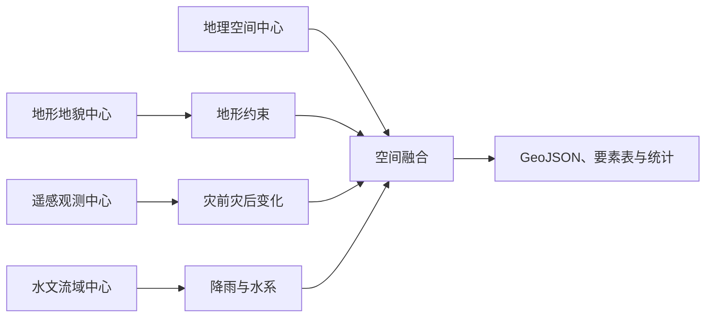

# 灾情应急：多中心数据融合

[English](emergency.md) · [首页](../README_zh.md)

在 CONET 门户打开 `/apps/emergency/`。界面采用中文。选择地震或泥石流模板，绘制矩形／多边形，设置事件位置、时间后提交分析。任务完成或手动选择历史结果之前，结果区保持空白。

## 数据与执行

可复现随机种子为 `20261107`。默认生成 **1,004,268,424 字节**合成输入：16 个瓦片，每个 1,400 × 1,400 像素，分辨率 10 米，EPSG:32648 下覆盖约 56 × 56 千米。位置为四川示意区域，默认事件时间为 2026-08-14 08:00 UTC。

| 数据中心 | 数据集 | 内容 |
|---|---|---|
| 地形地貌 | emergency-terrain | 高程与坡度 GeoTIFF |
| 遥感观测 | emergency-imagery | 灾前／灾后绿色及近红外 GeoTIFF |
| 水文流域 | emergency-hydrology | 降雨基线及距沟道距离 GeoTIFF |
| 地理空间 | emergency-exposure | 58 条道路、180 个聚落及设施要素 |

固定 [Job](../cases/emergency/job.yaml) 填充 `REGION`、`EVENT`、`SIMULATION`、`CHANGE_THRESHOLD` 和从目录解析的源 URI。Union 将工作分配到四个源节点。算子复用 `xstream/check-dams-demo:1.0`，无需新增模型训练。输入及中间结果通过流传递，仅最终下载成果落盘。



## 演示方法

分析网格为 500 米。影像变化比例为双波段平均绝对变化超过 0.08 的像素占比；默认网格变化比例阈值为 0.15。

- 地震筛选结合变化比例、距事件距离、震级与坡度，演示评分阈值为 0.35；事件半径限制候选网格。
- 泥石流筛选另要求降雨 ≥120 毫米、坡度 12–45°、距沟道 ≤2,000 米、启发式评分 ≥0.45。用户设置的降雨量按比例缩放合成降雨基线。
- 候选网格合并后按精确多边形裁剪，并与暴露要素相交，统计疑似影响道路长度、聚落人口及设施。

这些是可解释的**演示启发式规则**，并非经过验证的地震损毁、泥石流预测、工程选址或安全路线模型。人口与设施均为合成数据。“未检出”不代表安全。

## 来源与缺测

研判时刻为事件发生后 12 小时。影像、水文、地形／暴露数据的时效阈值分别为 72、24、8,760 小时。每个数据源展示观测时刻、研判时刻、状态与原因。

界面提供影像缺测与水文过期演示。必需数据不足时返回 `complete: false`，影响统计为 null，暴露要素状态为 `unknown`。泥石流必需水文输入，地震筛选仅将其作为背景信息。历史合成观测不会标为实时数据。

## 可视化与下载

天地图支持平移、缩放、矩形／多边形选择和事件定位。合成灾前／灾后影像支持滑块对比。可切换疑似影响区、道路及设施，点击要素或列表查看依据。参见[地图配置与导出限制](maps_zh.md)。

下载包括 `impact.geojson`、`affected-assets.csv`、`analysis.json`、`sources.json` 及展开后的 `variables.yaml`。浏览器不接收 DACP 凭据。后端校验几何与事件范围，拒绝跨站提交，限制队列并仅提供白名单成果。

## 生成与验证

```bash
.venv/bin/python cases/emergency/generate_data.py .state/cases/emergency/data
bin/conet up
.venv/bin/python scripts/smoke_appbuilder.py
.venv/bin/python -m unittest discover -s tests
```

生成器拒绝覆盖已有输出目录。数据、本地算子包、凭据和结果均保存在 Git 忽略的 `.state/`，Git 仅包含源码与生成命令。

四中心端到端测试已验证地震、泥石流、成果下载、多边形裁剪及缺测／过期场景。默认合成结果：地震疑似影响面积 208.5 平方千米、道路 228.0 千米；泥石流为 75.0 平方千米、76.5 千米。两种数据不足场景的影响统计均为 null。这些数字仅描述合成测试数据，不代表真实灾情。

四个仅源码算子为 `emergency_terrain`、`emergency_imagery`、`emergency_hydrology` 和 `emergency_fusion`，版本均为 1.0。使用已有的[仓库提交命令](deployment_zh.md)登记并进入审核。CONET 本地管理员安装的算子库独立于公开仓库审批状态。
