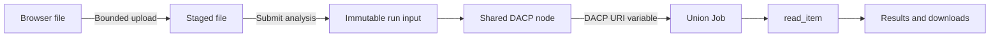

# Upload files as application inputs

Visitors can upload a file in the application form without logging in. CONET streams it to staging storage, checks the extension and size, and returns an opaque upload reference. Submission binds a server-generated DACP Item URI to a fixed Job variable. Clients cannot supply a filesystem path or substitute their own URI for an upload reference.



## Configure a file field

```yaml
inputs:
  - name: source
    label: Input file
    widget: file
    required: true
    extensions: [.csv]
    max_bytes: 16777216
    view: bytes
variables:
  INPUT_URI: {input: source}
```

```yaml
name: Uploaded input
steps:
  - id: read_input
    operator: read_item@1.0
    params: {uri: $INPUT_URI, view: bytes}
    inputs: {}
outputs: {result: read_input}
```

Use XStream's actual `$INPUT_URI` variable syntax. Binding a file field supplies its Item URI, not its metadata object. `read_item.params.view` must match the field's configured `view`. `records` is suitable for structured streams consumed by downstream operators; `bytes` exposes the original content, including ZIP roots. Selecting a view does not convert an unsupported format into records. Nested file fields in object groups are supported using dotted input bindings.

The effective upload maximum is the smaller of field `max_bytes` and `hosting.max_upload_bytes` (16 MiB by default, at most 64 MiB). Empty files and invalid extensions are rejected. File contents are validated by the selected format reader during execution, not just by the filename extension. Uploads are single-file requests without resumable transfer. The editor's form preview displays the control without uploading; publish/load the application to use it.

## Storage and retention

All eight Node members—seven scientific data centers and one shared center—remain connected to the Union. The shared center stores application input files. Each accepted submission receives a separate immutable run directory and an `input-<run-id>` dataset, addressed with the shared node's full `dacp://…` URI. Input datasets are excluded from public Catalog listings; direct reads still use the DACP node's normal authorization. Workspaces require no login and do not provide user privacy. Upload identifiers are not user authentication.

```yaml
appbuilder:
  uploads:
    retention_days: 7
    quota_bytes: 1073741824
hosting:
  max_upload_bytes: 16777216
```

Staged files expire after the configured number of days. Run inputs remain readable during active execution; their retention starts when execution ends, including failure and cancellation. Restart-interrupted inputs acquire the same retention period during cleanup. Cleanup runs every minute and skips active runs. Storage is under `.state/hosting/inputs/`; private execution descriptors are under `.state/hosting/execution-inputs/`. Input storage has a separate total quota, counting staged and run files. Inputs are not automatically included in shared result products; filename, bytes, SHA-256, selected view, URI and retention information remain in the run provenance. Published results may contain information derived from those inputs.

## API and examples

`POST /apps/<app>/api/uploads/<field>` accepts an `application/octet-stream` body and a percent-encoded `X-File-Name` header, with the normal same-origin mutation check. It returns `upload_id`, name, bytes, SHA-256, view and expiration. Then submit `{"source":{"upload_id":"<id>"}}` to `/apps/<app>/api/jobs`. The upload reference is scoped to that application and field. Preview validates references but allocates run Items only on submission.

See [CSV application](../examples/uploaded-csv/application.yaml) and [JSON application](../examples/uploaded-json/application.yaml). The CSV application reads original bytes through a real Union Job, then uses the `csv-table` presentation plugin for tables and numeric-column statistics. It is a bounded file-analysis example, not a distributed aggregation benchmark. It supports UTF-8 CSV with optional BOM, quoted/multiline cells, at most 16 MiB, 100,000 rows and 256 unique columns. Values stay textual; statistics count finite numeric cells. Preview shows the first 200 rows; CSV downloads include all accepted rows and escape spreadsheet formulas. Statistics, analysis JSON, provenance and reports are also downloadable.

```bash
python3 scripts/build_application_package.py examples/uploaded-csv /tmp/uploaded-csv.conet.zip
python3 scripts/smoke_uploaded_csv.py --url http://127.0.0.1:8870
```

## Remote Items

File inputs offer upload and remote DACP Item modes. Remote mode submits `{"uri":"dacp://host:port/dataset/item.csv"}`, binds the same Job variable and creates no local upload copy. The server validates paths, required views and known file sizes; folders are accepted only for an explicitly advertised bytes view requested by the input. URI user information, queries and fragments are rejected. Connections verify server identity using the configured CA and never forward Union credentials to user-supplied origins. The execution target must still be able to access and read the Item.
