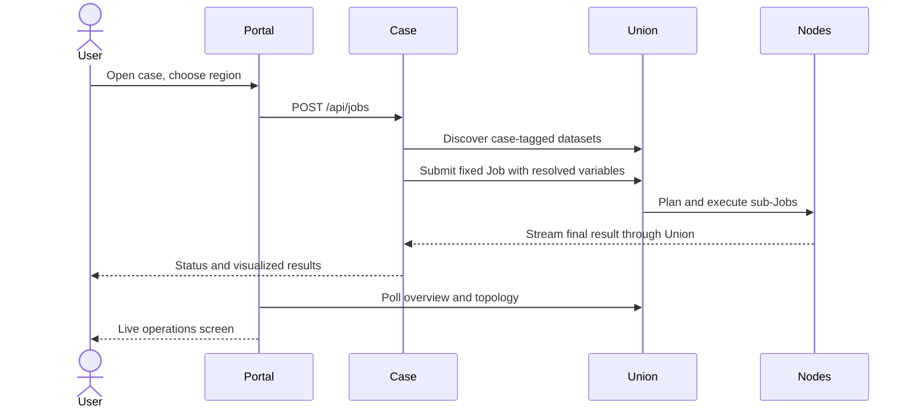

# Platform and extension contracts

[中文](platform_zh.md) · [Home](../README.md)

## Services and ownership

`network.py` creates the shared DACP nodes, credentials and Union. `manage.py` manages their lifecycle and the case applications. `server.py` serves the portal, proxies configured case HTTP backends and polls Union observations. The portal does not implement a new execution engine, data transport or authorization protocol.

## Register a case

The implemented extension boundary is a configured case HTTP backend, its source directory and associated datasets. Add an entry to `conet.yaml` with `id`, Chinese `title`, `title_en`, `description`, `directory`, and an unused loopback `port`. Provide `app.py` accepting `--host/--port` and `demo.py` exporting `build_operators()`. Both must honor `CONET_CASE_STATE`. The operator installer returns a versioned local library under that state directory. Add the case's datasets under centers, with unique names, `case`, `title` and `description`. Case data must exist at `.state/cases/<case-id>/data/<center-id>/` before startup.

Required backend HTTP routes:

| Route | Contract |
|---|---|
| `GET /api/config` | Public, no credentials; manifest, template and dashboard links |
| `GET /api/jobs` | Array with `id`, `state`, `created_at`, optional `summary` |
| `GET /api/jobs/<id>` | Job detail, Union Job ID, execution observations, result and artifact links |
| `POST /api/jobs` | Validated JSON variables; HTTP 202 with queued Job; HTTP 400 for bad input |
| `GET /results/<id>/<file>` | Allowlisted completed artifacts only |

Use `/cases/<id>/` for public links. The portal strips this prefix before forwarding. Static HTML/JS, API fetches and artifact URLs must include the public prefix. Case backends must not expose credentials. Included backends have one executor thread, a four-outstanding-request limit, persisted records and restart interruption markers. They accept JSON up to 16 KiB; the portal rejects cross-origin POSTs.

The `centers` list in `conet.yaml` determines the network size; the launcher and portal are not limited to three centers. Current names are illustrative and do not represent real institutions. Each center has an independent `id`, `title`, optional `location`, and `datasets`. The optional dataset `directory` selects a subdirectory inside its case data directory and defaults to the center ID. Restart the network after adding centers. Existing case generators produce three data sources; additional centers require corresponding data directories. Custom analysis algorithms belong in case operators rather than portal or transport code. New file formats/backends should use XStream extension contracts, rather than format-specific core branches. Case registration does not constitute sandboxing of the case application's source.

## Observability

`GET /api/config` returns public case/center definitions. `GET /api/snapshot` returns a cached snapshot, refreshed every three seconds using concurrent, three-second-timeout upstream requests. An unavailable case/member must not block the other observations. Center mapping uses actual configured node URIs rather than list ordering. Stale observations and unavailable measurements are labeled; no synthetic health or traffic values are invented.

The topology uses Union's `/api/topology`: receiver-observed task payloads over the latest attempt of up to 100 recent Jobs. It is **not a lifetime network-byte total**. Rates use deltas for identical active sample keys and increasing observation timestamps; absent comparable samples display `—`. Membership links indicate organization and are not counted as traffic. Union-to-client final output traffic is not supplied by that topology endpoint and is not fabricated. CPU and heap values come from member resource reports; participation comes from Union's participation counts. Cases report cumulative completed-analysis summaries, not unique-object counts across repeated selections.

## Security and storage

The browser has no service credentials. A backend runner account accesses the Union; accepted Union membership permits the configured node operations. Private keys and Tokens remain under ignored `.state/`. The platform uses local configuration for administration and provides no remote account-management API. For public deployment, apply your normal reverse-proxy/access boundary and operational hardening.

## Globe screen and identity

The screen uses an Asia-centered draggable globe, translucent side panels, member callouts, task-payload curves, status rings and case data/operator labels. Metrics come from live snapshots. An operator label's size reflects references in configured Job templates, not popularity. Online rate is the proportion of configured nodes with fresh approved observations. The top bar reports configured datasets, distinct template operators, visible case Jobs and currently online nodes. Unknown resources remain unknown.

Each center's optional `location` in `conet.yaml` has `longitude`, `latitude` and `label`. The bundled Lanzhou/Beijing/Kunming coordinates are **illustrative**: all seven demo services run on one machine. The globe texture comes from [three.js example assets](https://github.com/mrdoob/three.js/blob/dev/examples/textures/planets/earth_atmos_2048.jpg); the accompanying license is `web/assets/threejs-LICENSE.txt`. It is bundled locally, and the globe does not need an external map API. Node locations and source-data footprints are different concepts.

CONET's SVG identity is `web/assets/conet-mark.svg`: four outer nodes connect through a central hub, with a subtle perimeter link expressing a cooperative network. It is used in the portal, screen, case headers and browser icons.

### Per-center data volume

The portal cards and screen show the logical file size of the datasets published by each configured center, summed across cases. Overlapping dataset paths within a center are counted once. Archive files count by their stored file size, without adding their expanded contents. Missing or unreadable data is displayed as `—`; this is neither disk capacity nor transfer volume. Values refresh with the status snapshot.

### Seven-center deployment and live motion

The default network contains Northwest, North China, Southwest, East China, Central China, South China and Northeast China science data centers, all local demonstration nodes. The original six scientific inputs remain published by the first three centers. The other four publish a tile-coverage index, a band index, analysis settings and a survey reference. `scripts/generate_reference_data.py` derives these small datasets from case manifests and actual settings automatically on startup; it may also be run separately. They do not duplicate the GB-scale inputs or imply that each analysis uses all seven centers. Per-center volumes show real file sizes.

Online nodes have a breathing halo. Moving packets appear only when real transfer samples are active. Payload totals and rates use measured values, with `—` for unknown rates. A reduced-motion preference disables these animations.

Center names combine region, discipline and “Data Center”. The Northwest, North China and Southwest centers publish both geoscience-related data and astronomical catalogs, so their names include both disciplines. East China focuses on geographic information, Central and Northeast China on astronomy, and South China on geoscience. These are demonstration names, not real institutions.
