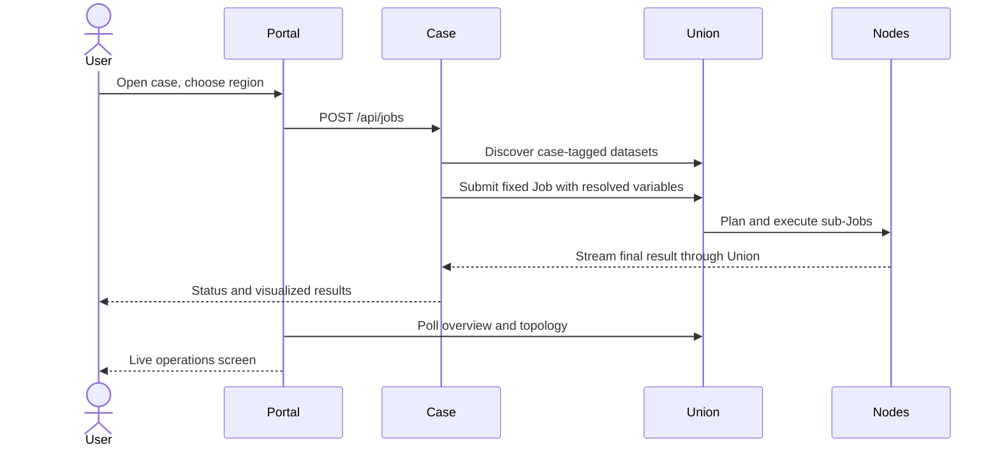
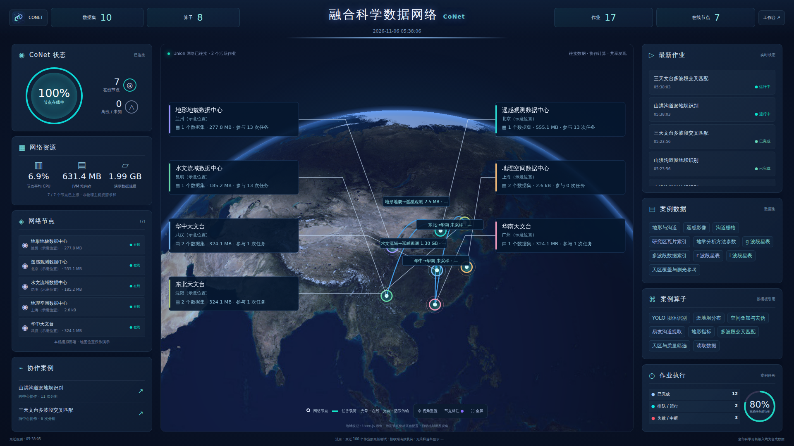

# Platform and extension contracts

[中文](platform_zh.md) · [Home](../README.md)

## Services and ownership

The Scala application owns network lifecycle (`Network`), process management (`Manager`), the portal and live screen (`Web`), and case submission and result processing (`CaseService`). One JVM serves the portal and all three case HTTP listeners. It calls the DACP Scala SDK directly and polls Union observations. The portal does not implement a new execution engine, data transport or authorization protocol.

## Register a case

Case configuration in `conet.yaml` declares `id`, Chinese `title`, `title_en`, `description`, `directory`. Each case contains a fixed `job.yaml`, Python scientific operators under `operator/`, and versioned operator YAML descriptors under `manifests/`. Optional `packaging.yaml` maps operator names to additional archive entries under `assets`; values are paths relative to case state and may reference locally managed symbolic links. Packaging replaces archives atomically after all inputs are available. `Operators.build` packages these descriptors and sources into the local execution library. Add datasets with unique names, `case`, `title` and `description`; prepare data under `.state/cases/<case-id>/data/<center-id>/`. Applications configure inputs, variable bindings, result views and themes through App Builder `application.yaml`, and are published at `/apps/<id>/`.

Required backend HTTP routes:

| Route | Contract |
|---|---|
| `GET /api/config` | Public, no credentials; manifest, template and dashboard links |
| `GET /api/jobs` | Array with `id`, `state`, `created_at`, optional `summary` |
| `GET /api/jobs/<id>` | Job detail, Union Job ID, execution observations, result and artifact links |
| `POST /api/jobs` | Validated JSON variables; HTTP 202 with queued Job; HTTP 400 for bad input |
| `GET /results/<id>/<file>` | Allowlisted completed artifacts only |

Use `/apps/<id>/` for public links. The portal strips this prefix before dispatching to its Scala case service. Static HTML/JS, API fetches and artifact URLs must include the public prefix. Case backends must not expose credentials. Included backends have one executor thread, a four-outstanding-request limit, persisted records and restart interruption markers. They accept JSON up to 16 KiB; the portal rejects cross-origin POSTs.

The `centers` list in `conet.yaml` determines the network size; the launcher and portal are not limited to three centers. Current names are illustrative and do not represent real institutions. Each center has an independent `id`, `title`, optional `location`, and `datasets`. The optional dataset `directory` selects a subdirectory inside its case data directory and defaults to the center ID. Restart the network after adding centers. Existing case generators produce three data sources; additional centers require corresponding data directories. Custom analysis algorithms belong in case operators rather than portal or transport code. New file formats/backends should use XStream extension contracts, rather than format-specific core branches. Scientific operators run in their configured execution environments.

## Observability

`GET /api/config` returns public case/center definitions. `GET /api/snapshot` returns a cached snapshot, refreshed once per second after the preceding refresh completes using concurrent, three-second-timeout upstream requests. An unavailable case/member must not block the other observations. Center mapping uses actual configured node URIs rather than list ordering. Stale observations and unavailable measurements are labeled; no synthetic health or traffic values are invented.

The topology uses Union's `/api/topology`: receiver-observed task payloads over the latest attempt of up to 100 recent Jobs. It is **not a lifetime network-byte total**. Rates use deltas for identical active sample keys and increasing observation timestamps; absent comparable samples display `—`. Membership links indicate organization and are not counted as traffic. Union-to-client final output traffic is not supplied by that topology endpoint and is not fabricated. CPU and heap values come from member resource reports; participation comes from Union's participation counts. Cases report cumulative completed-analysis summaries, not unique-object counts across repeated selections.

## Security and storage

The browser has no service credentials. A backend runner account accesses the Union; accepted Union membership permits the configured node operations. Private keys and Tokens remain under ignored `.state/`. CONET provides freely selectable organizational workspaces without login or role review. Node service credentials remain administrator-managed; see [workspaces](workspaces.md). For public deployment, apply your normal reverse-proxy/access boundary and operational hardening.

## Globe screen and identity

The screen uses an Asia-centered draggable globe, translucent side panels, member callouts, task-payload curves, status rings and case data/operator labels. Metrics come from live snapshots. An operator label's size reflects references in configured Job templates, not popularity. Online rate is the proportion of configured nodes with fresh approved observations. The top bar reports configured datasets, distinct template operators, visible case Jobs and currently online nodes. Unknown resources remain unknown.

Each center's optional `location` in `conet.yaml` has `longitude`, `latitude` and `label`. The bundled Lanzhou/Beijing/Kunming coordinates are **illustrative**: all seven demo services run on one machine. The globe texture comes from [three.js example assets](https://github.com/mrdoob/three.js/blob/dev/examples/textures/planets/earth_atmos_2048.jpg); the accompanying license is `web/assets/threejs-LICENSE.txt`. It is bundled locally, and the globe does not need an external map API. Node locations and source-data footprints are different concepts.

CONET's SVG identity is `web/assets/conet-mark.svg`: four teal nodes joined into a continuous network on a pale teal rounded square express connected participants and collaborative analysis. The portal, screen, published applications and browser icons share this asset.

### Per-center data volume

The portal cards and screen show the logical file size of the datasets published by each configured center, summed across cases. Overlapping dataset paths within a center are counted once. Archive files count by their stored file size, without adding their expanded contents. Missing or unreadable data is displayed as `—`; this is neither disk capacity nor transfer volume. Values refresh with the status snapshot.

### Seven-center deployment and live motion

The default network contains four disciplinary data centers (Terrain and Geomorphology, Remote Sensing, Hydrology and Watershed, and Geospatial) and three regional observatories (Central, South and Northeast China), all local demonstration nodes. The terrain, imagery and channel inputs are published by the Terrain, Remote Sensing and Hydrology centers. The g/r/i catalogs are published by the Central, South and Northeast China observatories. The Geospatial center publishes tile indices and analysis settings; the Central and Northeast observatories also publish band indices and survey references. The Scala `ReferenceData` component derives these small datasets from case manifests and actual settings automatically on startup. They do not duplicate the GB-scale inputs or imply that each analysis uses all seven centers. Per-center volumes show real file sizes.

Online nodes have a breathing halo. Moving packets appear only when real transfer samples are active. Payload totals and rates use measured values, with `—` for unknown rates. A reduced-motion preference disables these animations.

### Movable screen panels

Drag a title to reorder panels within either side rail or move a panel to the other rail. A bright line previews the insertion point. Panels dock into the rail on release and cannot float over the central globe. Dropping outside a rail or pressing Escape preserves the original position. The browser stores rail order locally and restores it on reload; the panel-reset button restores defaults. Panels and their lists expand to show all content without internal scrollbars. Each side rail provides a single scroll area when its panels exceed the available height. Tab focuses a title, up/down arrows reorder it and left/right arrows move it to the corresponding rail. Dragging does not affect globe rotation, content links or content interactions.

### Flow and sampling

Snapshots and the screen refresh approximately once per second. Directed links show cumulative task payload, sampled rate and activity state. Newly observed byte increments animate for four seconds: cyan denotes still-active samples, gold denotes a recently observed transfer, and blue denotes historical links. Completed or stale samples do not animate indefinitely as live transfers. Rates require two valid byte observations; unknown values display `—`. Globe interactions and redraws do not consume rate samples.

### Geographic node labels

Data-center names appear directly beside their globe nodes, without cards, borders, extra metrics or leader lines. Text placement avoids nodes and other names where possible. Clicking a map node, name or left-side node entry opens a dismissible detail box at the upper-left with status, volume, location, datasets and resources. Task-transfer curves and compact traffic labels remain visible. Mouse text selection is disabled throughout the screen; panel dragging, globe rotation, links and buttons remain available.

The default globe framing is raised to place China and the demonstration nodes near the middle of the central canvas. Nodes, names and task curves share the globe projection; resetting the view restores this framing.

The legend sits at the lower-left edge and controls at the lower-right edge. They wrap compactly within their corners on narrow canvases, leaving the middle available for nodes, data flows and labels.

The default view centers China and the seven demonstration centers while retaining a visible curved Earth limb and atmospheric glow. Task links are thin, translucent, gently curved lines. Compact traffic labels show only payload totals and rates and avoid nodes and names; when space is insufficient, hovering the link exposes complete information.

Inter-node line width follows a logarithmic mapping of cumulative task payload bytes, bounded to 0.5–2.25 pixels: larger totals produce thicker lines. Unknown or zero payload uses the minimum width. Width does not represent instantaneous rate, which remains in the traffic label. Hover increases brightness without changing width; arrowheads retain a fixed size.

### Union node and traffic

The Union coordinator is shown as a faceted three-dimensional star above Beijing (116.4074° E, 39.9042° N). Its illustrative elevation follows the globe projection as the view rotates; a dashed altitude guide and ground point distinguish its geographic anchor from task traffic. Union is labeled simply “Union”; its member links are thin straight lines with a 0.5-pixel stroke. Center and Union icons share the same soft outer glow when hovered or selected. Each member-to-Union link represents task result payload, separate from direct member task transfers. Totals, rates, widths and activity particles use receiver-side measurements of task data frames, excluding heartbeats, authorization, status polling and other control frames. The scope is the latest attempts of the most recent 100 jobs. Historical jobs without these observations remain unobserved rather than zero. Direct member transfers that bypass Union are not added to Union links. Click Union for a summary.

Data centers use shaded spherical markers without outer rings, preserving each center’s color and its online status indicator. Both center and Union symbols use half their original size; labels retain their readable size.

Center details show the dataset count and total logical size of published files, without per-dataset rows. Overlapping roots are counted once in the center total; unavailable sizes display “—”.

Left-rail center icons use the same artwork at a compact 13 × 13 pixels.

Idle Union links fade gently between 6% and 26% opacity over seven seconds. Hover and measured task transfers brighten them; the fading does not indicate data activity. Reduced-motion settings use a steady faint line.

Click a recent job on the operations screen to open its physical-plan DAG in a modal. It uses the Union dashboard renderer and actual job details, including execution servers, process units, dependencies and observed traffic. The modal defaults to vertical swimlanes with a dark blue palette matching the screen. Title and layout toolbars are hidden; discreet corner controls fit the graph or refresh the plan. Drag to pan and click graph elements to inspect them. Close with the close button, backdrop or Escape. Jobs not yet submitted, unavailable plans and service errors receive explicit messages. Read-only same-origin routes expose only fixed DAG assets and job-detail lookups against the configured Union; no client-supplied server destinations are accepted.

The operational network has eight Node members: the existing seven scientific data centers and one shared hosting center. The Union coordinates them and is not counted as a Node. The shared center also serves temporary application inputs; see [file inputs](file-inputs.md).
