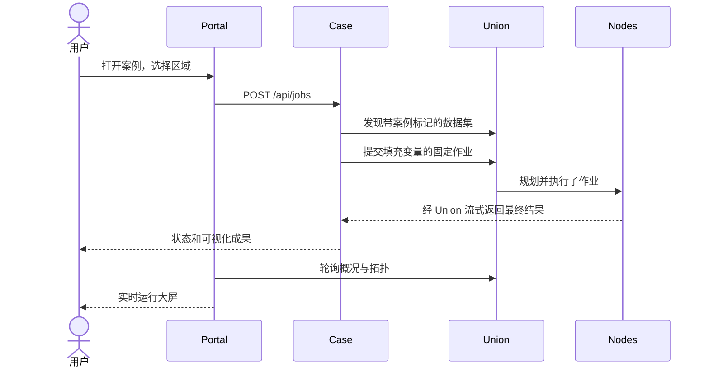

# 平台与扩展契约

[English](platform.md) · [首页](../README_zh.md)

## 服务与职责

Scala 应用负责网络生命周期（`Network`）、进程管理（`Manager`）、门户与大屏（`Web`）、案例提交及结果处理（`CaseService`）。一个 JVM 提供门户和三个案例的 HTTP 监听，直接调用 DACP Scala SDK，并轮询 Union 观测。门户不另建执行引擎、数据传输或授权协议。

## 注册案例

`conet.yaml` 中的案例配置声明 `id`、中文 `title`、`title_en`、`description` 和 `directory`。每个案例包含固定的 `job.yaml`、`operator/` 下的 Python 科学算子，以及 `manifests/` 下带版本的算子 YAML 描述。可选的 `packaging.yaml` 在 `assets` 下按算子名声明额外归档条目，值为相对案例状态目录的路径，可引用本机管理的符号链接。全部输入准备成功后才原子替换归档。`Operators.build` 将描述和源码打包到本地执行库。增加具有唯一名称、`case`、`title`、`description` 的数据集，并在 `.state/cases/<case-id>/data/<center-id>/` 准备数据。应用通过 App Builder 的 `application.yaml` 配置输入、变量绑定、结果视图和主题，并在 `/apps/<id>/` 发布。

后端须实现以下 HTTP 路由：

| 路由 | 契约 |
|---|---|
| `GET /api/config` | 公开且不含凭据；包含 manifest、模板和看板链接 |
| `GET /api/jobs` | 数组，包含 `id`、`state`、`created_at`，可含 `summary` |
| `GET /api/jobs/<id>` | 任务明细、Union 作业 ID、执行观测、结果和成果链接 |
| `POST /api/jobs` | 校验 JSON 变量；202 返回排队任务，400 表示输入错误 |
| `GET /results/<id>/<file>` | 仅提供白名单中的完成成果 |

公开链接采用 `/apps/<id>/`，门户分派至 Scala 案例服务前移除此部分。静态 HTML/JS、API 请求和成果 URL 均须包含此前缀。案例后端不得暴露凭据。内置后端为单执行线程，最多允许四个待处理任务，持久化记录，并在重启时标记中断任务。JSON 请求上限 16 KiB，门户拒绝跨站 POST。

中心列表由 `conet.yaml` 的 `centers` 配置决定，启动器和门户不限定为三个中心。当前中心名称均为演示名称，不代表真实机构。每个中心配置独立的 `id`、`title`、可选 `location` 和 `datasets`；数据集的可选 `directory` 指向案例数据目录内的子目录，默认使用中心 `id`。新增中心后重新启动网络。现有案例的数据生成脚本仍生成三个数据来源；增加中心需要准备相应数据目录。自定义分析算法应放在案例算子中，而不是门户或传输代码。新文件格式和后端应使用 XStream 扩展契约，不在核心增加特定格式分支。科学算子在配置的执行环境中运行。

## 可观测性

`GET /api/config` 返回公开案例和中心定义。`GET /api/snapshot` 返回缓存快照，每次刷新完成一秒后再次并发请求上游，单次超时三秒。某个案例或成员不可用时，不应阻塞其他观测。中心映射依据配置中的实际节点 URI，不依赖列表排序。过期观测和不可用指标会明确标记，不生成虚构健康状态或流量。

拓扑采用 Union 的 `/api/topology`，统计最多最近 100 个作业最新尝试中接收端观测的任务载荷，**不是网络全生命周期总量**。速率使用相同活跃采样键且观测时间递增时的增量；无可比采样则显示 `—`。成员关系线表示组织关系，不计为流量。该拓扑接口不提供 Union 向客户端返回最终结果的流量，页面不虚构此数值。CPU、堆内存取自成员资源报告；参与次数取自 Union 统计。案例成果为已完成分析的累计数量，同一区域重复运行的目标不做跨任务去重。

## 安全与存储

浏览器不持有服务凭据。后端以 runner 账号访问 Union；成员接纳 Union 后允许其执行配置范围内的节点操作。私钥和 Token 保存在被忽略的 `.state/` 下。CONET 提供免登录、可自由选择的工作空间，用于组织资源。节点服务凭据仍由管理员维护，见[工作空间](workspaces_zh.md)。面向公网部署时，应使用已有反向代理、访问边界和运维加固措施。

## 地球大屏与视觉标识

大屏采用以亚洲为中心、可拖动的地球、半透明侧栏、成员引线、任务载荷曲线、状态环以及案例数据/算子标签。指标取自实时快照；算子标签大小反映配置中作业模板的引用次数，不代表热度。在线率为配置节点中具有新鲜获准观测的比例；顶部显示配置数据集数、模板不同算子数、可见案例作业数和当前在线节点数。未知资源仍显示未知。

中心可在 `conet.yaml` 中配置可选 `location`，含 `longitude`、`latitude`、`label`。内置兰州/北京/昆明坐标**仅为示意**，七个演示服务均运行于同一台机器。地球纹理来自 [three.js 示例资源](https://github.com/mrdoob/three.js/blob/dev/examples/textures/planets/earth_atmos_2048.jpg)，许可附于 `web/assets/threejs-LICENSE.txt`。纹理随项目提供，大屏不依赖外部地图 API。节点位置与源数据覆盖区域是两个不同概念。

CONET 的 SVG 标识位于 `web/assets/conet-mark.svg`：浅青色圆角方形内，四个青绿色节点连成连续网络，表达参与方之间的连接与协同分析。门户、大屏、已发布应用和浏览器图标共用此资源。

### 各中心数据量

门户卡片和大屏展示各中心所发布数据集的文件逻辑字节数，跨案例汇总。同一中心内重叠的数据集路径只统计一次；归档文件按其存储文件大小计入，不重复累加展开内容。数据缺失或不可读时显示 `—`。该值不是磁盘容量或传输流量，随状态快照刷新。

### 七中心部署与动态状态

默认网络包含地形地貌、遥感观测、水文流域、地理空间四个学科数据中心，以及华中、华南、东北三个地域天文台，均为本机演示节点。三个地学输入由地形地貌、遥感观测、水文流域中心发布，g/r/i 星表分别由华中、华南、东北天文台发布。地理空间中心发布瓦片索引和分析方法参数，华中、东北天文台另提供波段索引和天区参考。这四类数据由 Scala `ReferenceData` 组件从案例清单及实际参数生成，启动时自动准备。它们是小型参考数据，不复制 GB 级输入，也不表示每次分析都会调用七个中心。各节点的数据量按真实文件大小显示。

大屏在线节点使用呼吸光晕；仅当真实传输采样处于活跃状态时显示沿链路运动的光点。累计载荷与速率保持真实采样值，未知速率显示 `—`。系统开启减少动画偏好时关闭这些动画。

### 可拖动的大屏面板

拖动标题栏可在左右侧栏内调整面板顺序，也可移至另一侧栏。插入位置以亮线标识；松开后自动排列，不能停留在中央地图或自由浮动。松开在侧栏之外或按 Esc 则保留原位置。浏览器本地记住两侧的排列，刷新后恢复；“面板复位”恢复默认排列。面板及其内部列表完整展开，不提供内部滚动条；左右侧栏分别提供一个滚动区域，内容超出侧栏时可滚动查看。Tab 聚焦标题，上下方向键调整顺序，左右方向键移至对应侧栏。拖动不影响地球旋转、内容链接。

### 流动与采样

状态快照与大屏每约 1 秒刷新一次。连线带有方向箭头、累计任务载荷、采样速率及状态。观察到新的字节增长后，动画保留 4 秒：青色表示采样仍活跃，金色表示刚发生的传输，蓝色为历史链路。完成或过期采样不会持续冒充实时传输。速率仅由两次有效字节观测计算，未知显示 `—`。地球旋转及显示重绘不消耗速率采样。

### 节点标注

数据中心名称直接显示在地球上的节点附近，不显示卡片、边框、附加指标或引导线。文字位置尽量避开节点及其他名称。点击地图节点、名称或左侧节点列表，在左上角打开可关闭的详情框，展示状态、数据量、地域、数据集与资源。任务传输曲线及紧凑流量标签继续显示。整个大屏禁止鼠标选择文字，但保留面板拖动、地球旋转、链接和按钮操作。

地球默认上移，使中国及演示节点群接近中央画布中部。节点、名称和任务曲线共用地球投影，重置视角恢复这一构图。

图例贴近画布左下角，控制按钮贴近右下角；窄画布中各自在角落紧凑换行，将中间区域留给节点、数据流和标注。

默认视角使中国及七个演示中心位于中央画布中部，同时保留可见的地球弧形边缘与大气光晕。任务连线采用细、半透明的轻弯曲线，流量标签仅显示累计量和速率，并避开节点及名称；空间不足时通过连线悬停提示查看完整信息。

节点间连线宽度按累计任务载荷字节数作对数映射，限制为 0.5–2.25 像素：累计传输量越大，连线越粗；未知或零传输量使用最细线。线宽不表示瞬时速率，实时速率仍由标签单独显示。悬停仅提高亮度，不改变线宽；箭头保持固定尺寸。

### Union 节点与流量

Union 协调节点以具有立体切面的星形图标悬浮在北京（东经 116.4074°、北纬 39.9042°）上空，示意高度随地球投影和视角旋转。虚线高度引导与地面锚点标明地理锚点，并与任务流量连线区分。节点名称仅显示“Union”，与各成员采用 0.5 像素细直线连接。数据中心与 Union 图标在悬停或选中时统一使用柔和外发光。每个成员与 Union 的链路展示任务结果数据载荷，保留与成员直连任务链路的区别。累计量、速率、线宽与活动光点都来自接收端对任务 data 帧的实测，不包含心跳、授权、状态查询和其他控制帧。统计使用最近 100 个作业的最新尝试。历史作业没有该项观测时显示“未采样”，不能把未知记成零。没有经过 Union 的成员间数据不计入 Union 链路。点击 Union 可查看汇总。

数据中心采用具有明暗层次、无外围圆环的立体球形图标，保留各中心的配色和在线状态指示。数据中心与 Union 图形均缩至原尺寸的 50%，文字保持可读字号。

数据中心弹出详情汇总显示数据集数量和已发布文件的逻辑总大小，不按数据集分列；中心总量对重叠目录去重，无法取得的数据量显示“—”。

左侧列表使用同款节点图形，尺寸为紧凑的 13 × 13 像素。

空闲 Union 连线以七秒周期在 6% 至 26% 透明度之间柔和变化；悬停或实测任务传输时提高亮度。明暗变化仅为装饰，不代表正在传输数据；减少动态效果设置下使用固定低亮度。

点击大屏中的最新作业，在站内弹窗中查看物理计划 DAG。图形复用 Union 看板渲染器和真实任务详情，展示执行服务器、进程执行单元、依赖关系与已观测流量。默认采用竖直泳道布局，使用与大屏协调的深蓝色调；隐藏标题和布局工具栏，仅保留角落的适应画布、刷新和关闭按钮。支持拖动平移和点击查看图形要素详情。关闭按钮、点击遮罩或 Escape 可关闭弹窗。尚未提交、计划未生成及服务不可用时明确提示。同源只读接口仅提供固定 DAG 资源与已配置 Union 的任务详情查询，不接受浏览器指定任意服务器地址。

运行网络包含八个 Node 成员：原有七个科学数据中心及一个共享托管中心。Union 负责协调，不计入 Node 数量。共享中心还承载临时应用输入，见[文件输入](file-inputs_zh.md)。
