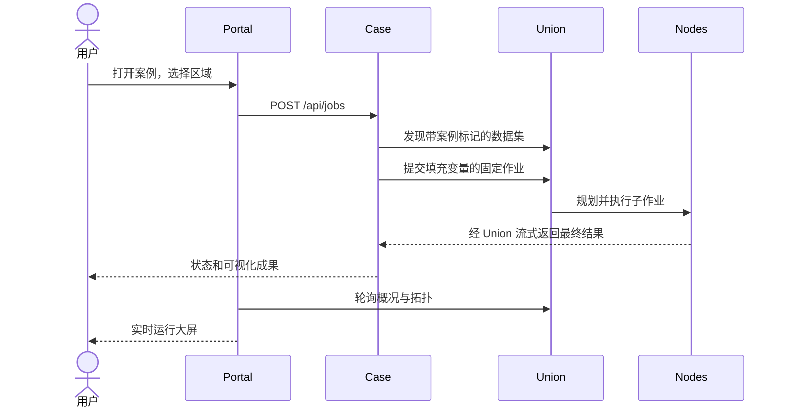

# 平台与扩展契约

[English](platform.md) · [首页](../README_zh.md)

## 服务与职责

`network.py` 创建共享 DACP 节点、凭据和 Union，`manage.py` 管理这些服务及案例应用的生命周期。`server.py` 提供门户、代理配置中的案例 HTTP 后端并轮询 Union 观测。门户不另建执行引擎、数据传输或授权协议。

## 注册案例

已实现的扩展边界是配置化案例 HTTP 后端、源码目录和关联数据集。在 `conet.yaml` 增加包含 `id`、中文 `title`、`title_en`、`description`、`directory` 和空闲回环 `port` 的条目。提供接受 `--host/--port` 的 `app.py` 和导出 `build_operators()` 的 `demo.py`，二者都须遵循 `CONET_CASE_STATE`。算子安装器在该状态目录下建立版本化本地库。在中心中加入具有唯一名称、`case`、`title` 和 `description` 的数据集。启动前须在 `.state/cases/<case-id>/data/<center-id>/` 准备好案例数据。

后端须实现以下 HTTP 路由：

| 路由 | 契约 |
|---|---|
| `GET /api/config` | 公开且不含凭据；包含 manifest、模板和看板链接 |
| `GET /api/jobs` | 数组，包含 `id`、`state`、`created_at`，可含 `summary` |
| `GET /api/jobs/<id>` | 任务明细、Union 作业 ID、执行观测、结果和成果链接 |
| `POST /api/jobs` | 校验 JSON 变量；202 返回排队任务，400 表示输入错误 |
| `GET /results/<id>/<file>` | 仅提供白名单中的完成成果 |

公开链接采用 `/cases/<id>/`，门户转发前移除此部分。静态 HTML/JS、API 请求和成果 URL 均须包含此前缀。案例后端不得暴露凭据。内置后端为单执行线程，最多允许四个待处理任务，持久化记录，并在重启时标记中断任务。JSON 请求上限 16 KiB，门户拒绝跨站 POST。

当前启动器支持这些案例需要的三个中心 `a/b/c`。自定义分析算法应放在案例算子中，而不是门户或传输代码。新文件格式和后端应使用 XStream 扩展契约，不在核心增加特定格式分支。案例注册本身不提供应用源码的沙箱隔离。

## 可观测性

`GET /api/config` 返回公开案例和中心定义。`GET /api/snapshot` 返回缓存快照，每三秒以并发方式请求上游，单次超时三秒。某个案例或成员不可用时，不应阻塞其他观测。中心映射依据配置中的实际节点 URI，不依赖列表排序。过期观测和不可用指标会明确标记，不生成虚构健康状态或流量。

拓扑采用 Union 的 `/api/topology`，统计最多最近 100 个作业最新尝试中接收端观测的任务载荷，**不是网络全生命周期总量**。速率使用相同活跃采样键且观测时间递增时的增量；无可比采样则显示 `—`。成员关系线表示组织关系，不计为流量。该拓扑接口不提供 Union 向客户端返回最终结果的流量，页面不虚构此数值。CPU、堆内存取自成员资源报告；参与次数取自 Union 统计。案例成果为已完成分析的累计数量，同一区域重复运行的目标不做跨任务去重。

## 安全与存储

浏览器不持有服务凭据。后端以 runner 账号访问 Union；成员接纳 Union 后允许其执行配置范围内的节点操作。私钥和 Token 保存在被忽略的 `.state/` 下。平台通过本地配置管理，不提供远程账号管理 API。面向公网部署时，应使用已有反向代理、访问边界和运维加固措施。

