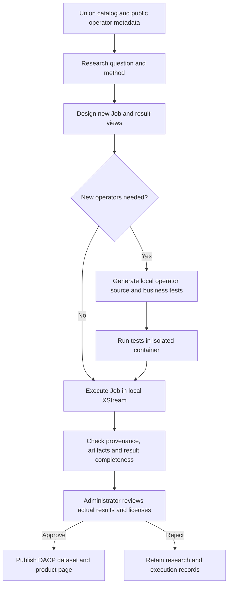

# Autonomous product processing

[中文](product-robot_zh.md) · [Publish products](products.md)

Open **Data products** (`/products/`) to browse live, published analysis products. Both manually published results and robot-generated products approved by an administrator appear here. Search by title or application, filter by origin, open the independent product page or copy the DACP dataset URI. Withdrawn and expired publications disappear from this list.

**Product processing robot** (`/product-robot/`) is the single-user management page. It shows scheduling, research records, workflow designs, local operator source/tests, quality checks, results and approval decisions. Management uses the existing deployment access controls; it does not introduce accounts or login. Restrict management access at the reverse proxy or network boundary when deploying publicly.

## Research and processing

The robot periodically studies the current Union catalog, bounded root Item metadata and small samples of explicitly public datasets. It reads configured public operator catalogs, then asks the configured model to propose a useful new product: a research question, method, limitations, a new Job, parameters, result views and, when needed, new local operators. It does not select from published applications. Recent research is included to discourage repeated work. The planner may skip a round when it cannot identify a useful new task.



Generated operators use the Python SDK and a host-selected, installed image pinned by Docker image ID. Local manifests and build settings are generated by the host. The model cannot choose host commands, image names, dependency installers or filesystem paths. Tests run with a read-only filesystem, no network, 512 MiB memory, a PID limit and a 60-second deadline. Execution uses XStream containers with no network, bounded memory and temporary space; remote Item access goes through a host adapter restricted to the recorded source Item URIs. The model does not receive connection credentials.

Jobs execute locally, with remote reads through the configured Union. Local operator packages are never submitted to DACP nodes or Union. Jobs can reuse public operators and create up to four local Transform operators; a round has at most 16 steps. An explicit `client_sink@1.0` returns the single JSON result. This first implementation supports source `bytes` and `records` views; scientific arrays retain their published structure and are not silently flattened. New operator dependencies must already be available in the selected image. Model-produced tests establish only their stated checks, not scientific correctness.

At most one robot analysis runs at a time. The shared application scheduler also applies global capacity and disk admission limits. A queue of ten pending approvals pauses new research. An overdue run blocks further robot submissions until it terminates or is cancelled. Pausing the schedule stops future rounds; it does not cancel an active analysis. Use the record's **Cancel** action for cancellation. Stopping CONET closes robot services and cancels their active local executions.

## Approval and publishing

A successful Job is not published automatically. Candidate checks require recorded sources and operators, a nonempty artifact with SHA-256, no explicit incompleteness or warnings, and nonempty configured tabular results. Failed checks retain the record for inspection and rejection. These structural checks are not a claim of scientific validity or product value.

Review the research question, source Items, parameters, code/tests, Job DAG and actual visualized results. **Approve and publish** requires a review note and the existing explicit application/source rights declaration. Unknown rights block publication; known prohibitions and configured owners/licenses cannot be relaxed. Approval publishes immutable results through the shared DACP node, with the research, workflow snapshot and approval record in metadata/report. Pending and rejected candidates are not included in `/api/products` or the public gallery. A robot-owned run cannot use the ordinary publication endpoint to bypass approval.

Synthetic source datasets force a synthetic marker on their results; model output cannot remove it. Reviewers must not treat synthetic demonstrations as real scientific findings.

## Traceability and replay

Each research record has a candidate ID, workflow ID, run ID, research rationale, original proposal, inputs, resolved Job, quality checks and review outcome. The immutable workflow bundle contains the application/result definition, Job, local operator code and tests, studied source Item metadata and public operator contracts. SHA-256 checks cover the persisted files; the local runtime image ID is pinned. Local test logs are retained under each workflow’s `test-reports/`, and native XStream execution histories under `executions/`. A shared `operator-cache/` stores repository artifacts. Saved context includes the model identifier, planning instructions and instruction digest. Failed sample reads are recorded in the research context and cannot be selected as sources. Robot submissions and observed dataset/operator/node events are included in aggregate usage statistics.

Download the JSON workflow bundle from a record for inspection or backup. This is an audit bundle, not an App Builder `.conetapp` import. It contains no server credential files. The original operator library and cached artifacts must be retained with `.state/product-robot/` to replay on this installation.

**Replay** creates a new tracked candidate and execution with the saved workflow, parameters, code, tests and runtime; it does not ask the model to redesign the Job. It rechecks source Item presence, sizes, modification times, views and schema, and refuses changed or missing sources. Its result needs a fresh quality check and approval. Replay never silently overwrites or republishes the original product.

Remote input bytes are not snapshotted. Matching metadata cannot prove that remote content is unchanged, and data may change during a run. Bit-identical reproduction requires immutable/versioned source datasets and retention of the pinned runtime and public operator artifacts. The implementation does not promise bit-identical scientific results from mutable remote datasets. Back up robot state, source versions, caches, shared-node products and their declarations together.

## Configuration

```yaml
appbuilder:
  page_generation:
    codex_config: /etc/conet/model.toml
  product_robot:
    enabled: true
    interval_seconds: 1800
    max_run_seconds: 3600
    repositories: [https://operators.example.org]
    local_runtime:
      runtime: python-arrow@1.0
      image: sha256:REPLACE_WITH_INSTALLED_IMAGE_ID
```

The image must be installed and use a real 64-hex-digit Docker image ID, not the placeholder. It must include the XStream Python SDK, Python standard library and dependencies needed by generated code. The CONET service account needs Docker access. No source code is executed on the host during the Python package build. Additional repository operators use their registered runtimes and existing download verification.

`product_robot.codex_config` optionally selects a separate server-side model configuration; otherwise the existing `page_generation.codex_config` connection is used. The provider must support the Responses API. Tokens remain in the server configuration/environment and are never included in bundles or Git. Each round makes one bounded model request; the default model deadline is 240 seconds. Rejected or invalid model plans are recorded without submitting a Job.

Intervals range from 60 seconds to 30 days; observation limits range from 60 seconds to 24 hours. The first scheduled check is delayed by one minute. Schedule toggles and the next planned time persist under `.state/product-robot/schedule.json`; a saved toggle takes precedence over the initial `enabled` value. Restart recovers observation of recorded runs and marks ambiguous planning/submission records interrupted rather than blindly submitting them again. There is no automatic approval.

## HTTP interface

| Method | Path | Meaning |
|---|---|---|
| GET | `/api/products` | Live published products only |
| GET | `/api/product-robot` | Schedule and research records |
| POST | `/api/product-robot/run` | Start one research round with `{}` |
| POST | `/api/product-robot/settings` | Set `{"enabled":true}` or `false` |
| GET | `/api/product-robot/<id>` | Research and execution record |
| GET | `/api/product-robot/<id>/bundle` | Immutable workflow audit bundle |
| POST | `/api/product-robot/<id>/replay` | Replay saved workflow with `{}` |
| POST | `/api/product-robot/<id>/cancel` | Cancel its active analysis with `{}` |
| POST | `/api/product-robot/<id>/approve` | `review_note`, `rights`, `confirmed`, `downloads` |
| POST | `/api/product-robot/<id>/reject` | Required `review_note` |

Mutations require JSON and reject cross-origin requests. Administration is single-user and has no authentication layer: the same-origin check is not a substitute for deployment access restrictions. Existing independent product URLs and withdrawal/expiration rules remain in effect.
