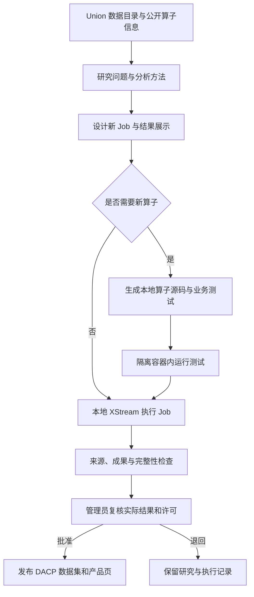

# 自主产品加工

[English](product-robot.md) · [发布数据产品](products_zh.md)

打开 **数据产品**（`/products/`），浏览当前已发布的分析产品。人工发布的成果和经过管理员审批的机器人产品统一展示，可按标题或应用搜索、按来源筛选、打开独立产品页或复制 DACP 数据集 URI。撤回或过期的产品从列表移除。

**产品加工机器人**（`/product-robot/`）是单用户管理页面，提供调度、研究记录、流程设计、本地算子源码与测试、质量检查、结果和审批操作。管理沿用现有部署的访问限制，不增加账号或登录。公网部署时，应在反向代理或网络边界限制管理入口。

## 研究与加工

机器人定期研究当前 Union 目录、有限数量的根 Item 元数据，以及明确公开数据集中小型文件的样例；同时读取配置的公开算子目录。模型据此提出有价值的新产品：研究问题、方法、限制、新 Job、参数、结果展示，以及必要的新本地算子。它不从已发布应用中选择流程。近期研究会纳入上下文以减少重复；没有合理新任务时可以跳过本轮。



生成的算子使用 Python SDK，运行于主机指定、已安装且固定 Docker 镜像 ID 的环境。本地清单和构建配置由主机生成，模型不能选择主机命令、镜像、依赖安装器或文件系统路径。测试采用只读文件系统、无网络、512 MiB 内存、进程数限制和 60 秒期限。实际加工使用 XStream 无网络容器，并限制内存和临时空间；远程 Item 通过主机适配器访问，限制为本次记录的来源 Item URI。模型不会收到连接凭据。

Job 在本地执行，经配置的 Union 读取远程数据。本地算子包不会提交给 DACP 节点或 Union。流程可复用公开算子，每轮最多创建四个本地 Transform 算子、最多包含 16 个步骤；以显式 `client_sink@1.0` 返回单一 JSON 结果。首轮实现支持来源的 `bytes`、`records` 视图，科学数组保留已发布的结构，不静默展平成记录。新算子的依赖需预先存在于所选镜像。模型生成的测试仅证明其明确覆盖的检查，不代表科学正确性。

机器人同时最多执行一次分析，共享应用调度器的全局容量和磁盘准入限制仍生效。待审批积压达到十项时暂停新增研究。超过观察期限的任务在结束或取消前阻止新增机器人任务。暂停调度仅停止后续轮次，不取消当前分析；可用记录中的**取消**操作取消分析。停止 CONET 会关闭机器人服务并取消其正在执行的本地分析。

## 审批与发布

Job 成功不会自动公开产品。候选检查要求：来源和算子已记录、存在带 SHA-256 的非空成果文件、没有明确不完整标记或警告、已配置的表格结果非空。检查失败的记录保留供查看和退回。这些结构检查不代表科学有效性或产品价值已经确认。

审批时检查研究问题、来源 Item、参数、代码与测试、Job DAG 和实际可视化结果。**审批并发布**必须填写审批意见，并沿用应用和每项数据来源的显式许可声明。未知许可阻止发布，已有禁止性许可及已配置的权利人、许可证不能放宽。批准后通过共享 DACP 节点发布固定成果，并在元数据和报告中记录研究、流程快照与审批信息。待审批和退回成果不会进入 `/api/products` 或公开产品列表；机器人运行不能绕过审批从普通发布接口直接发布。

合成来源会强制使结果标记为合成数据，模型不能去除此标记；不能把演示成果视为真实科研发现。

## 追溯与重放

每轮研究包含候选编号、流程编号、运行编号、研究依据、原始提案、输入、填充变量后的 Job、质量检查和审批结果。固定流程包包含应用与结果定义、Job、本地算子代码和测试、研究时的来源 Item 元数据与公开算子契约。保存文件具有 SHA-256 校验，运行环境固定为镜像 ID；本地测试日志保存在各流程的 `test-reports/`，XStream 原生执行历史保存在 `executions/`；共享 `operator-cache/` 保存仓库制品。保存的上下文包含模型名称、规划提示词及其摘要。采样读取失败会记入研究上下文，相应来源不能被选用。机器人提交任务及实际观测的数据集、算子、执行节点事件计入整体使用统计。

可从记录下载 JSON 流程包用于检查和备份。它是审计包，并非可导入 App Builder 的 `.conetapp` 程序包，也不包含服务端凭据文件。在本部署重放需同时保留 `.state/product-robot/` 中的原始本地算子库和缓存产物。

**重放本次加工**会以保存的流程、参数、代码、测试及环境创建新的候选和执行，不请求模型重新设计。重放核对来源 Item 是否存在，以及大小、修改时间、视图和 schema；变化或缺失则拒绝。新结果仍须重新检查和审批，不会覆盖或重新发布原始产品。

远程输入字节不会被快照。元数据相同并不能证明内容相同，运行中数据也可能变化。逐字节复现需使用不可变、带版本的数据集，同时保留固定镜像和公开算子产物；对于可变远程数据，系统不承诺完全相同的科研结果。请共同备份机器人状态、来源版本、缓存、共享节点产品及许可声明。

## 配置

```yaml
appbuilder:
  page_generation:
    codex_config: /etc/conet/model.toml
  product_robot:
    enabled: true
    interval_seconds: 1800
    max_run_seconds: 3600
    repositories: [https://operators.example.org]
    local_runtime:
      runtime: python-arrow@1.0
      image: sha256:REPLACE_WITH_INSTALLED_IMAGE_ID
```

镜像必须已安装，使用真实的 64 位十六进制 Docker 镜像 ID，而不是示例占位值。镜像需包含 XStream Python SDK、Python 标准库及生成代码所需依赖。CONET 服务账号需要访问 Docker。Python 算子打包期间不会在主机执行生成源码。复用的仓库算子使用各自注册的运行环境和已有下载校验。

可通过 `product_robot.codex_config` 指定独立的服务端模型配置，否则复用已有 `page_generation.codex_config` 连接；提供方须支持 Responses API。Token 仅存在于服务端配置或环境，不进入流程包或 Git。每轮一次受限制的模型请求，默认期限为 240 秒。无效或被拒绝的模型计划只保留失败记录，不提交 Job。

周期为 60 秒至 30 天，观察期限为 60 秒至 24 小时；初次定时检查延迟一分钟。调度开关和下次时间保存在 `.state/product-robot/schedule.json`，已保存开关优先于初始 `enabled` 配置。重启后恢复已有运行的观察，对状态不明确的规划或提交记录标记中断，不盲目重复提交。系统不会自动批准产品。

## HTTP 接口

| 方法 | 路径 | 含义 |
|---|---|---|
| GET | `/api/products` | 仅当前已发布产品 |
| GET | `/api/product-robot` | 调度与研究记录 |
| POST | `/api/product-robot/run` | 使用 `{}` 开始一轮研究 |
| POST | `/api/product-robot/settings` | 设置 `{"enabled":true}` 或 `false` |
| GET | `/api/product-robot/<id>` | 研究及执行记录 |
| GET | `/api/product-robot/<id>/bundle` | 固定流程审计包 |
| POST | `/api/product-robot/<id>/replay` | 使用 `{}` 重放保存的流程 |
| POST | `/api/product-robot/<id>/cancel` | 使用 `{}` 取消其当前分析 |
| POST | `/api/product-robot/<id>/approve` | `review_note`、`rights`、`confirmed`、`downloads` |
| POST | `/api/product-robot/<id>/reject` | 必填 `review_note` |

修改操作要求 JSON 并拒绝跨源请求。管理采用单用户方案，无认证层；同源检查不能替代部署访问限制。独立产品地址、撤回和过期规则仍然生效。
