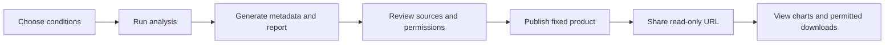

# Publish and share analysis products

Product pages provide section links for the dataset, results, execution records and rights. Inputs and result summaries sit side by side on wide screens; identifiers, contribution details, detailed permissions, limitations and publication management expand on demand. The process DAG and its prose explanation appear side by side on wide screens and stack on mobile. Result tables preview at most ten rows.

Process descriptions expand version-specific operator explanations from `config/process-descriptions.yaml` (override with `appbuilder.process_descriptions`). Templates use JSON pointers such as `{{/params/min_snr}}` and `{{/source_summary}}`. Read steps identify the node, dataset and Item from the saved URI and catalog metadata; unavailable metadata falls back to the recorded URI. Explanations are grouped by dependency stage and never change the executed Job. Operators without detailed descriptions are explicitly identified as undocumented rather than assigned invented behavior.

The analysis-process section shows the variable-resolved Job DAG and a deterministic prose summary of its dependency stages, plus execution-node names. The App link appears in the analysis conditions and execution records section. Node identities and sub-job identifiers are omitted from this section.

The “撤回发布” action withdraws the published dataset and product page while preserving the original analysis history and archive. Previously downloaded copies remain with their recipients.

Both the data catalog and workspace open the same product detail page. Its upper section uses the shared dataset browser: description, DACP/S3 addresses, metadata, folders, Items and bounded previews. The lower section adds visualized results, analysis conditions, execution records, provenance, rights and publication management. Original datasets use the dataset browser alone.

[中文](products_zh.md) · [App Builder](appbuilder.md)

An application is a reusable analysis form. An **analysis product** is the fixed result of one successful run, with its conditions, provenance, artifacts and rights declaration. Editing the application later does not change a published product.



Published products are DACP datasets on the shared node. The publication response includes `dataset_id`, `dataset_uri`, `preview_url` and `expires_at`. Use `dataset_uri` as the data address; `preview_url` opens the browser presentation. Metadata includes `metadata_uri`, `report_uri` and an `item_uri` for each downloadable artifact. Publishing declares the snapshot public; withdrawal removes the dataset from the Catalog.

## Publish from a result

1. Complete an analysis on `/apps/<id>/` or load a completed run from its history.
2. Click **发布并分享本次结果**. Review the automatically generated source and artifact lists.
3. The publisher is recorded as CONET; author and source attribution are provided separately. Fill in the application author/license and each source's data rights holder, hosting provider, license and attribution requirements. Rights declarations are self-declared and are not proof of real-world ownership.
4. Confirm permission to display derived results. Select download artifacts only when all relevant parties permit their download. Commercial use has a separate permission.
5. Confirm the declaration and publish. Copy the independent `/products/<random-id>/` address.
6. Manage or withdraw the product without logging in. Withdrawal also removes its dataset from the shared hosted Catalog.

Publishing requires explicit permission for the application and every referenced source. Unknown permissions block publication. Existing configured prohibitions and known rights holders/licenses cannot be rewritten during publication. All artifacts derive from the Job's single output and conservatively inherit all referenced source conditions. Optional per-artifact rules can further restrict public display or downloads. Conflicts require human resolution; the software does not adjudicate ownership or license compatibility.

A product page shows results directly, without authoring navigation or rerunning a Job. Product metadata and the Markdown report remain downloadable; only selected and permitted result files have download links. Visualization necessarily sends display data to the browser: hiding file downloads is not copy protection. Review the actual result before making it public.

## Automatically generated description

Every newly completed run writes `metadata.json` and `report.md`, alongside its configured artifacts. They include:

- Purpose, deterministic narrative, analysis ID and synthetic-data marker.
- Input values and configured units; missing units are not inferred.
- Submission/start/finish times and measured duration.
- Application and Job content hashes, operator IDs/versions and configured operator contributors.
- Referenced Item URIs/views, dataset bindings and observed execution nodes. Source reads are explicitly marked `observed` or `referenced`.
- Result summaries, configured collection sizes, GeoJSON coordinate extents, and available completeness/warning fields.
- Artifact names, formats, byte sizes, SHA-256 checksums and CSV record counts.
- Observed usage events for source, operator and node contributions.
- On publication: party declarations, licenses, attribution, permissions, publisher and expiration.

Secret-named parameter values and URI user information/query credentials are redacted from descriptive metadata. Raw results still require review before publication. Unknown versions, contributors and licenses remain unspecified. A successful execution does not imply complete input data or scientific validity. Descriptions are generated from actual records without model inference.


## Configure storage and retention

```yaml
appbuilder:
  products:
    directory: /srv/conet/.state/hosting/products
    retention_days: 30
```

The root is server-owned and may be an absolute path or a path relative to CONET. Each product has its own directory containing fixed data, public metadata/report and a private `publication.json` management record. Same-filesystem hard links avoid duplicating result bytes; otherwise files are copied. Deleting original run artifacts does not remove the published files.

Expiration and revocation immediately stop public page/API/file access. Hourly cleanup removes expired/revoked product payload links and retains the private metadata/declaration audit record. Original application history and cached artifacts are retained independently. Back up both product storage and application state; deleting a published payload deliberately is permanent. This storage implementation uses a filesystem; configure a suitably managed mounted volume when needed.

## Configure attribution and permissions

In **结果与下载 → 署名与许可**, configure application and dataset policy defaults before executing the Job. The variable bindings determine the dataset policy list. A completed run keeps its own configuration snapshot; publication does not silently adopt later application edits.

The YAML representation supports additional operator attribution and per-artifact restrictions:

```yaml
publication:
  application:
    name: Example application author
    license: Permission to publish derived demonstration results
    attribution: Cite the application and its version.
    view: allowed
    download: allowed
    commercial: denied
  sources:
  - dataset: g-band
    provider: Observatory data center
    rights_holder: Example data rights holder
    license: Example agreed data license
    attribution: Cite the dataset and its version.
    view: allowed
    download: allowed
    commercial: denied
  operator_contributors:
  - operator: example@1.0
    name: Example operator author
    license: Example software license
    attribution: Follow the software attribution terms.
  outputs:
    analysis:
      download: denied
```

Configure every relevant source, not only the first one in this illustration. Permission values are `allowed`, `denied` and `unconfirmed`. Source policies match `dataset`, or an explicit `uri` when no dataset binding exists. Each artifact's ID identifies its additional rule; `analysis` identifies the result JSON used by the visualizations. Software attributions are recorded without asserting that a software license automatically determines ownership of the resulting data.

## HTTP API

| Method and path | Purpose |
|---|---|
| `GET /apps/<app>/api/jobs/<run>/publication` | Generated description and policy defaults for review |
| `POST /apps/<app>/api/jobs/<run>/publication` | Publish with `rights`, `confirmed`, and selected `downloads` artifact IDs |
| `GET /products/<id>/` | Read-only result page |
| `GET /products/<id>/api` | Public metadata and rights declaration |
| `GET /products/<id>/data` | Data needed by the published visualizations |
| `GET /products/<id>/files/<file>` | Allowed artifact, metadata or report download |
| `POST /products/<id>/revoke` | Revoke using `{}` |

Expired or revoked products return HTTP 410. Invalid or unconfirmed declarations are rejected without publishing. Cross-origin mutations are rejected. Publication and withdrawal require no login. Public page/API/file access remains anonymous. Rights declarations are not automatically verified. See [workspaces](workspaces.md) for storage organization and the shared hosted Catalog.

[Autonomous product processing and gallery](product-robot.md)
