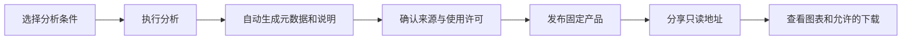

# 发布和分享分析产品

[English](products.md) · [App Builder](appbuilder_zh.md)

应用是可重复使用的分析表单；**分析产品**是某一次成功运行的固定结果，附带分析条件、来源、成果文件与权益声明。后续编辑应用不会改变已经发布的产品。



发布成果作为共享节点的 DACP 数据集提供。发布响应包含 `dataset_id`、`dataset_uri`、`preview_url` 和 `expires_at`；数据访问使用 `dataset_uri`，`preview_url` 用于浏览器展示。元数据包含 `metadata_uri`、`report_uri` 及每个允许下载成果的 `item_uri`。发布快照声明为公开，撤销后从目录移除数据集。

## 从分析结果发布

1. 在 `/apps/<id>/` 完成分析，或从历史记录加载已完成的运行。
2. 点击“发布并分享本次结果”，核对自动生成的数据来源与成果清单。
3. 发布者记录为 CONET，另行填写作者与来源署名。填写应用作者及许可，并逐项填写数据权利人、托管方、许可证和引用要求。权益声明为自报信息，不能作为现实数据权利的证明。
4. 确认允许公开衍生分析结果。只有相关各方均允许下载时，才选择成果下载文件。商业使用单独授权。
5. 确认声明并发布，复制独立的 `/products/<随机编号>/` 地址。
6. 无需登录即可管理和撤回产品；撤回也会取消共享托管 Catalog 中的数据集发布。

应用和全部引用来源必须明确允许公开；未确认的许可会阻止发布。发布时不能改写已经配置的禁止性许可、已知权利人或许可证。所有成果来自 Job 的同一个输出，保守继承全部引用来源的许可条件；可以为各文件设置更严格的公开或下载限制。条件冲突需要人工解决，软件不判定所有权或许可证兼容性。

产品页面直接显示结果，不出现编辑入口，也不会重新执行 Job。元数据和 Markdown 说明可下载；仅对选中且获准的成果提供下载链接。可视化必然会向浏览器传输展示数据，隐藏下载入口不是防复制机制。公开前应核对实际成果。

## 自动生成的描述

每次新完成的运行都在成果目录写入 `metadata.json` 和 `report.md`，内容包括：

- 分析目的、基于记录生成的文字说明、分析编号和合成数据标记。
- 输入值及已配置的单位；不推测缺失的单位。
- 提交、开始、结束时间及实际耗时。
- 应用与 Job 的内容摘要、算子编号/版本及已配置的算子贡献者。
- 引用的 Item URI/视图、数据集绑定和已观察到的执行节点。来源读取明确区分 `observed` 和 `referenced`。
- 结果摘要、配置的数据集合大小、GeoJSON 坐标范围及已有的完整性/警告字段。
- 成果名称、格式、字节数、SHA-256 校验值及 CSV 记录数。
- 已观察到的数据源、算子和节点贡献事件。
- 发布后增加各方声明、许可、署名要求、权限、发布者和到期时间。

描述性元数据会遮盖名称涉及凭据的参数值及 URI 中的用户信息/查询凭据；原始成果仍须在公开前核对。未取得的版本、贡献者和许可证保留为未提供。执行成功不代表输入完整或结论科学有效。说明来自实际记录，不使用模型推断。


## 配置存储和保留期限

```yaml
appbuilder:
  products:
    directory: /srv/conet/.state/hosting/products
    retention_days: 30
```

存储根目录由服务端控制，可以是绝对路径或相对于 CONET 的路径。每个产品有独立目录，包含固定成果、公开元数据/说明及私有的 `publication.json` 管理记录。同一文件系统优先使用硬链接避免重复占用成果空间，否则复制文件。删除原始运行成果不会删除已发布文件。

到期或撤回后，公开页面、API 和文件立即停止访问。每小时清理到期/撤回产品的成果链接，保留私有元数据与声明审计记录。原应用历史与缓存成果独立保留。应同时备份产品存储和应用状态；主动删除已发布成果无法恢复。当前存储实现使用文件系统，可配置受管理的挂载卷。

## 配置署名与许可

在执行 Job 之前，通过“结果与下载 → 署名与许可”设置应用和数据集的许可默认值。数据集列表来自变量绑定。已完成的运行保留自己的配置快照，发布时不会静默采用应用后续修改。

YAML 还支持额外的算子署名和按成果文件配置的限制：

```yaml
publication:
  application:
    name: Example application author
    license: Permission to publish derived demonstration results
    attribution: Cite the application and its version.
    view: allowed
    download: allowed
    commercial: denied
  sources:
  - dataset: g-band
    provider: Observatory data center
    rights_holder: Example data rights holder
    license: Example agreed data license
    attribution: Cite the dataset and its version.
    view: allowed
    download: allowed
    commercial: denied
  operator_contributors:
  - operator: example@1.0
    name: Example operator author
    license: Example software license
    attribution: Follow the software attribution terms.
  outputs:
    analysis:
      download: denied
```

应配置全部相关来源，不限于示例中的第一项。权限值为 `allowed`、`denied` 和 `unconfirmed`。来源按 `dataset` 匹配；没有数据集绑定时可使用显式 `uri`。各成果的 ID 对应其附加限制；`analysis` 表示用于可视化的结果 JSON。软件署名会被记录，但不据此认定软件许可证自动决定产出数据的所有权。

## HTTP API

| 方法和路径 | 用途 |
|---|---|
| `GET /apps/<app>/api/jobs/<run>/publication` | 待核对的自动描述和许可默认值 |
| `POST /apps/<app>/api/jobs/<run>/publication` | 提交 `rights`、`confirmed` 和所选 `downloads` 成果 ID 发布 |
| `GET /products/<id>/` | 只读结果页 |
| `GET /products/<id>/api` | 公开元数据和权益声明 |
| `GET /products/<id>/data` | 公开可视化所需的数据 |
| `GET /products/<id>/files/<file>` | 获准成果、元数据或说明下载 |
| `POST /products/<id>/revoke` | 使用 `{}` 撤回 |

到期或撤回返回 HTTP 410。无效或未确认的声明被拒绝，不生成产品。跨站修改请求被拒绝。发布和撤回均无需登录。公开页面、API 和获准文件仍可匿名访问。系统不会自动核验权益声明。工作空间、存储及共享托管 Catalog 见[工作空间](workspaces_zh.md)。
