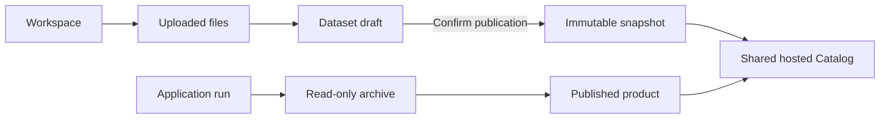

# Workspaces and shared hosting

Open `/workspace/` to create or select a workspace and manage datasets, applications and analysis products. No registration, login, session, role approval or remote-node enrollment is required. Workspaces organize resources; any visitor can select and maintain any workspace. Unpublished means absent from the DACP Catalog, not private access.

## Data and analysis products

Upload files, create folders and register a folder as a dataset. Publishing requires explicit confirmation and creates an immutable snapshot. Editing uploaded files does not alter an existing published snapshot. Withdraw and republish to update it. Successful analysis results are archived read-only; permitted result files, metadata and reports can be published as shared products. Expiry and withdrawal remove Catalog visibility and shared-page access.

All workspaces share one hosted DACP process. The remote execution network reuses the seven configured scientific nodes and their existing Union connections. Workspaces do not create remote nodes.



## Configuration and deployment

```yaml
hosting:
  enabled: true
  quota_bytes: 1073741824
  max_upload_bytes: 16777216
```

The default quota is 1 GiB per workspace; uploads default to 16 MiB each. Files are under `.state/hosting/spaces/<workspace-id>/`, workspace names and resource assignments in `.state/workspaces.json`. Publication descriptors are under `.state/hosting/publications/`. Only explicitly published descriptors enter Catalog through the `conet-hosted` DataCatalogProvider plugin. File formats use the node's installed format plugins.

```bash
sbt 'appbuilder/test' 'hosting/test' test stage
bin/conet restart-web
bin/conet hosting-status
```

`restart-web` preserves the existing nodes and Union. `hosting-up` and `hosting-down` manage the single shared hosted node. The server owns node credentials; none are exposed to browsers.

## API

| Endpoint | Purpose |
|---|---|
| `GET /api/workspaces` | List workspaces and current selection |
| `POST /api/workspaces` | Create with `{"name":"Research"}` |
| `GET /api/workspaces/resources` | Resource references in the selected workspace |
| `GET /api/storage/summary`, `/datasets`, `/results` | Capacity, dataset drafts and read-only archives |
| `POST /api/storage/list`, `/mkdir`, `/upload`, `/download`, `/delete` | File operations, each with the full `/api/storage` prefix |
| `POST /api/storage/dataset`, `/publish`, `/unpublish` | Dataset registration and publication |
| `GET /api/storage/result-files/<archive>/<file>` | Declared archived artifact |

Select a namespace with `X-Conet-Workspace: <id>`; omission selects the shared default. Ordinary artifact links can use `?workspace=<id>`. These identifiers are not credentials. Absolute paths, traversal, symbolic links and undeclared result files are rejected; upload quotas, immutable snapshots and cross-origin mutation checks apply. Place the portal behind an appropriate network boundary when needed.
