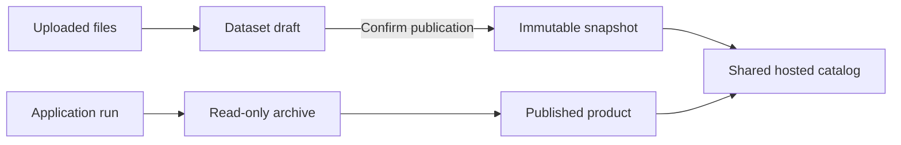

# Workspace and shared hosting

CONET is a single-user system. Open `/workspace/` to view all published apps and analysis products under “我发布的app” and “我发布的分析产品”. Apps, runs and products belong to the same user. Publication cards show their DACP URI and publication time. No login or workspace selection is required.

## Storage and publication

One shared DACP node hosts published datasets and analysis products alongside the seven scientific nodes connected to Union. Uploaded files and successful analysis archives use shared storage. Storage APIs support file operations and dataset publication. Publishing requires explicit confirmation and creates an immutable snapshot; editing an uploaded file does not alter a published snapshot. Successful analysis results are archived read-only. Only permitted artifacts, metadata and reports enter a published product. Withdrawal and expiry remove catalog visibility and shared-page access.



## Configuration and deployment

```yaml
hosting:
  enabled: true
  quota_bytes: 1073741824
  max_upload_bytes: 16777216
```

The default shared storage quota is 1 GiB; each file upload is limited to 16 MiB. Files, dataset drafts and result archives are under `.state/hosting/storage/`. Publication descriptors are under `.state/hosting/publications/`. Explicit publications enter the catalog through the `conet-hosted` DataCatalogProvider plugin; scientific formats use the node's installed format plugins. Product dataset metadata contains its product identifier and publication time, allowing the data catalog to label analysis products.

```bash
sbt test stage
bin/conet restart-web
bin/conet hosting-status
```

`restart-web` preserves existing nodes and Union; `hosting-up` and `hosting-down` manage the shared hosted node. Node credentials remain on the server.

## API

| Endpoint | Purpose |
|---|---|
| `GET /api/appbuilder/apps` | Published apps |
| `GET /api/products` | Active published analysis products |
| `GET /api/storage/summary`, `/datasets`, `/results` | Capacity, dataset drafts and read-only archives |
| `POST /api/storage/list`, `/mkdir`, `/upload`, `/download`, `/delete` | File operations; each path uses the `/api/storage` prefix |
| `POST /api/storage/dataset`, `/publish`, `/unpublish` | Dataset registration and publication |
| `GET /api/storage/result-files/<archive>/<file>` | Declared archive artifacts |

All requests use the same shared storage. Absolute paths, traversal, symbolic links and undeclared artifacts are rejected. Upload quotas, immutable snapshots and cross-origin mutation checks apply. Configure an appropriate network access boundary for the portal.
