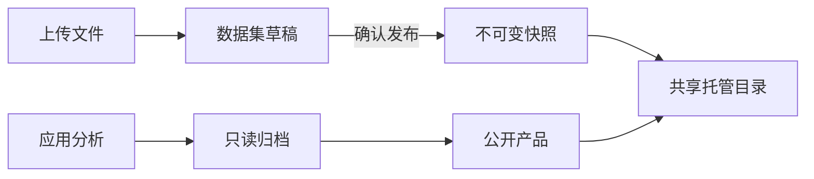

# 工作空间与共享托管

分析历史按 App 分组，组内展示应用简介及链接，可按执行状态和发布状态筛选。每次分析可打开已填充变量的 Job DAG，使用当次保存的模板及变量值，不受后续 App 编辑影响。新任务在提交执行前保存已解析的 Job；尚无变量值的任务会明确提示快照未就绪。

每条分析历史展示所属 App 的名称、标识和简介，提供打开 App 的链接，以及独立的本次分析记录入口。

CONET 是单用户系统。打开 `/workspace/`，通过“我发布的app”和“我发起的数据分析”查看已发布应用及全部分析历史。应用、分析记录和产品统一归当前使用者。每次分析展示执行状态，已发布成果列出 DACP URI 与发布时间，成功但未发布的记录可直接提交发布，无需登录或选择空间。

## 存储与发布

一个共享 DACP 节点托管已发布的数据集和分析产品，与七个科学节点一起连接 Union。上传文件及成功分析归档使用统一存储。存储 API 支持文件操作和数据集发布。公开发布必须明确确认，并创建不可变快照；修改上传文件不会改变已有快照。成功的分析结果只读归档，只有获准的成果文件、元数据与报告进入公开产品。撤回或到期会移除目录可见性并关闭分享页访问。



## 配置与部署

```yaml
hosting:
  enabled: true
  quota_bytes: 1073741824
  max_upload_bytes: 16777216
```

默认统一存储配额为 1 GiB，单文件上传上限为 16 MiB。文件、数据集草稿及分析归档位于 `.state/hosting/storage/`，发布描述位于 `.state/hosting/publications/`。明确发布的描述通过 `conet-hosted` DataCatalogProvider 插件进入目录，科学格式由节点已安装的格式插件处理。产品数据集元数据包含产品标识及发布时间，使数据目录能够将其标为“数据分析产品”。

```bash
sbt test stage
bin/conet restart-web
bin/conet hosting-status
```

`restart-web` 保留已有节点与 Union；`hosting-up`、`hosting-down` 管理共享托管节点。节点凭据保留在服务端。

## API

| 接口 | 用途 |
|---|---|
| `GET /api/appbuilder/apps` | 已发布应用 |
| `GET /api/analyses` | 全部分析历史及关联的有效发布信息 |
| `GET /api/products` | 当前有效的已发布分析产品 |
| `GET /api/storage/summary`、`/datasets`、`/results` | 容量、数据集草稿与只读归档 |
| `POST /api/storage/list`、`/mkdir`、`/upload`、`/download`、`/delete` | 文件操作，每项均使用 `/api/storage` 前缀 |
| `POST /api/storage/dataset`、`/publish`、`/unpublish` | 数据集登记与发布 |
| `GET /api/storage/result-files/<archive>/<file>` | 已声明的归档成果 |

所有请求使用同一套共享存储。拒绝绝对路径、目录穿越、符号链接和未声明的成果文件。上传配额、不可变快照及跨站修改校验保持有效。请为门户配置合适的网络访问边界。
