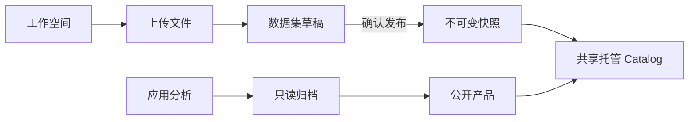

# 工作空间与共享托管

打开 `/workspace/` 创建或选择工作空间，维护数据集、应用和分析产品。所有功能无需注册、登录、会话、角色审批或远程节点登记。工作空间用于整理资源，任何访客都可以选择和维护任意空间。“未发布”表示不进入 DACP Catalog，不代表私密访问。

## 数据与分析产品

上传文件、新建目录，将目录登记为数据集。公开发布必须明确确认，并生成不可变快照。修改上传文件不会改变已有公开快照；更新时先撤回，再重新发布。成功的分析结果自动只读归档；允许下载的成果、元数据与报告可以发布为分享产品。到期或撤回会移除 Catalog 可见性并关闭分享页访问。

全部空间共用一个托管 DACP 进程。远程执行网络沿用已配置的七个科学数据节点及其现有 Union 连接。创建空间不会创建远程节点。



## 配置与部署

```yaml
hosting:
  enabled: true
  quota_bytes: 1073741824
  max_upload_bytes: 16777216
```

默认每空间配额 1 GiB，单文件上传上限 16 MiB。文件位于 `.state/hosting/spaces/<workspace-id>/`，空间名称及资源归类保存在 `.state/workspaces.json`。发布描述位于 `.state/hosting/publications/`。仅明确发布的描述通过 `conet-hosted` DataCatalogProvider 插件进入 Catalog，格式能力由节点已安装的格式插件提供。

```bash
sbt 'appbuilder/test' 'hosting/test' test stage
bin/conet restart-web
bin/conet hosting-status
```

`restart-web` 保留原有节点和 Union；`hosting-up`、`hosting-down` 管理唯一的共享托管节点。节点凭据由服务端维护，不发送到浏览器。

## API

| 接口 | 用途 |
|---|---|
| `GET /api/workspaces` | 空间列表与当前选择 |
| `POST /api/workspaces` | 使用 `{"name":"Research"}` 创建空间 |
| `GET /api/workspaces/resources` | 当前空间的资源引用 |
| `GET /api/storage/summary`、`/datasets`、`/results` | 容量、数据集草稿与只读归档 |
| `POST /api/storage/list`、`/mkdir`、`/upload`、`/download`、`/delete` | 文件操作，完整前缀均为 `/api/storage` |
| `POST /api/storage/dataset`、`/publish`、`/unpublish` | 数据集登记与发布 |
| `GET /api/storage/result-files/<archive>/<file>` | 已声明的归档成果 |

使用 `X-Conet-Workspace: <id>` 选择命名空间，未提供时使用默认共享空间。普通归档下载链接可使用 `?workspace=<id>`。这些标识不是凭据。拒绝绝对路径、目录穿越、符号链接和未声明的结果文件；保留上传配额、不可变快照及跨站修改检查。需要时由部署方为门户配置适当的网络访问边界。
